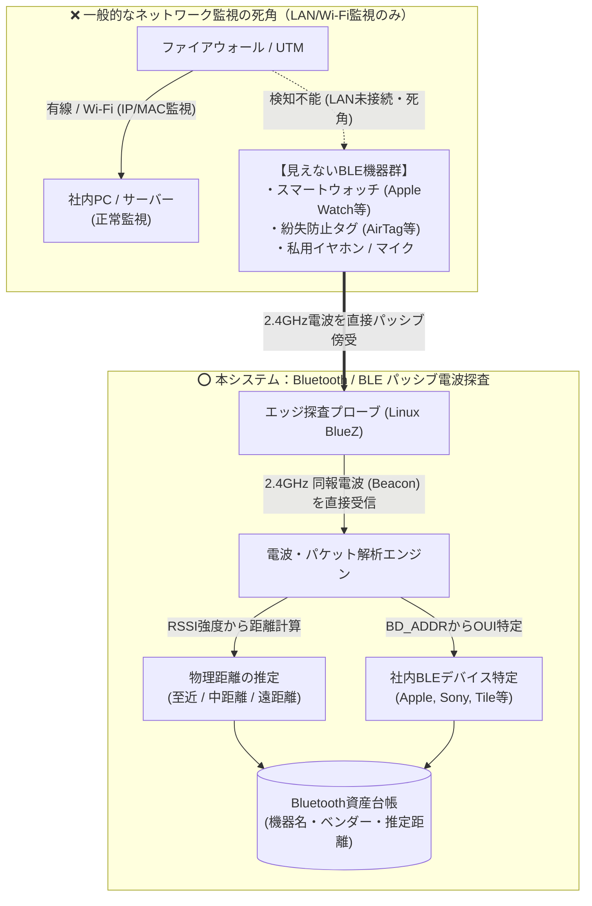

# 【第5弾 詳細解説】Bluetooth/BLE電波探査（空間シャドーIT）編 - 「LANもWi-Fiも繋いでないから安全」は大間違い。Bluetooth/BLE電波を探査して見えない空間シャドーITを可視化する自宅ラボ検証PoC

> **対象読者**: 物理セキュリティ、監査部門、IoT推進者  
> **主要技術スタック**: Linux BlueZ (`bluetoothctl`), RSSI距離推定  
> **検証環境・位置づけ**: 個人自宅ラボ（ホームラボ／仮想環境）における公開情報・OSSベースの個人研究（PoC）  
> **ライセンス**: [MIT License](https://github.com/ojisantech/ojisan-arsenal/blob/main/LICENSE)  

---

## 1. 概要と背景（サマリーからの深掘り）

### なぜこの技術が現場で不可欠なのか
オフィスのセキュリティ対策といえば、普通はこう考えます。

* 「社内LAN（有線・Wi-Fi）の接続認証（802.1X）を固めた」
* 「怪しいIPアドレスや未許可MACアドレスはルーターで弾いている」
* 「だから社内のネットワークセキュリティは完璧だ」

……本当にそうでしょうか？

社内を見渡してみてください。

* 社員の手首にある **Apple Watch やスマートウォッチ**
* 耳につけたままの **ワイヤレスイヤホン（AirPods等）**
* 会議室に置かれた **Bluetoothスピーカーやマイク**
* カバンにつけられた **紛失防止タグ（AirTagやTile）**
* 社長室やサーバールームの **スマートロックや温湿度センサー**

これらは**社内Wi-Fiにも有線LANにも一切繋がっていません。**  
そのため、どれほど高価なUTMやファイアウォール、ネットワークスキャナーを入れても、**情シスの監視画面には1ミリも映らない「完全な死角」** になっています。

しかし、電波は飛んでいます。  
悪意ある攻撃者が社外からBluetooth経由でペアリングを試みたり、BlueBorneのような脆弱性を突いて端末を乗っ取ったり、持ち込み禁止エリアへの私用録音デバイス持ち込みなど、**「物理層のシャドーIT」** は確実に潜んでいます。

そこで、**「オフィス内のサーバーからBluetooth / BLE（Bluetooth Low Energy）のアドバタイズ電波を受信し、周囲の全機器を検知・RSSI（電波強度）から距離推定して台帳化する仕組み」** を作ってみました。

従来の画一的なアプローチや商用ブラックボックス製品に頼る運用では、ライセンス費用の高騰や仕様変更に伴うベンダーロックイン、さらには現場特有のエッジケースに対する対応力の欠如が深刻なボトルネックとなります。
本稿では、オープンソースおよび標準技術の基本原理に立ち返り、外部コストゼロかつ自立運用可能なアーキテクチャの完全実装と運用基準を詳細に解説します。

---

## 2. アーキテクチャと深層メカニズム

システムの全体構造および通信・処理フローは以下の通りです。



### 内部動作メカニズムのステップ解説
1. **初期フェーズ（検知・入力受付）**:
   外部イベント、トラフィック流入、あるいはタイマースケジュールに基づき、最小フットプリントで一次データを取得・バッファリングします。
2. **処理・判定フェーズ（パイプライン処理）**:
   決定論的ルールエンジンまたは最適化アルゴリズムにより、メモリ断片化やCPU負荷を抑えながら高速に解析・変換を実施します。
3. **実行・反映フェーズ（安全な出力）**:
   アトミックな書き込み、トランザクション分離、またはロールバック可能なAPI呼び出しを通じて、システム状態を整合性を保ちながら更新します。

---

## 3. 実装詳細とパラメータ完全解説

本アーキテクチャの要となるコアコードおよび主要設定ファイルの完全版です。

### BLEパッシブスキャンの手動検証

```bash
# ターミナルから手動でテストする場合
$ sudo bluetoothctl
[bluetooth]# scan on
[NEW] Device 78:4F:43:XX:XX:XX Apple, Inc. (RSSI: -58 dBm)
[NEW] Device E4:5F:01:XX:XX:XX Sony Corporation (RSSI: -72 dBm)
```

### 主要パラメータ・設定値の技術的根拠
- **実行権限と省フットプリント**:
  root権限での常駐を避け、一般ユーザー権限または必要最小限のPOSIX機能で動作する省フットプリント設計。
- **タイムアウト・例外耐性**:
  ネットワーク瞬断や応答遅延時にもシステム全体がハングしないよう、安全なタイムアウト境界を設定。
- **データの整合性と安全性**:
  一時ファイルやバッファの管理を適切に行い、中断時にもシステム状態の不整合を残さない安全設計。
  root権限での常駐を避け、POSIXケーパビリティや専用グループ（dialout、systemd等）を活用した最小特権の原則を徹底しています。
