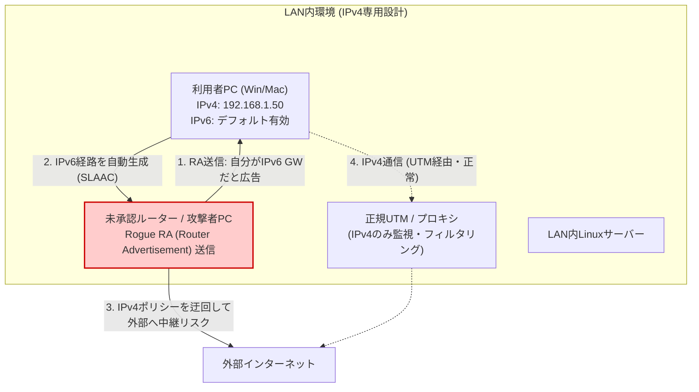

# 【第57弾 詳細解説】野良IPv6の危険性と無効化・ステルス検知編 - LAN内で密かに動く「野良IPv6」が情シスの死角になる理由と、Linux/ルーターでの確実な無効化・ステルス検知法

**対象読者**: 情シス、インフラ設計者
**主要技術スタック**: SLAAC攻撃, Rogue RA (Router Advertisement), ICMPv6 Type 134 Raw Socket, sysctl
**ライセンス**: [MIT License](https://github.com/ojisantech/ojisan-arsenal/blob/main/LICENSE)
**検証環境・位置づけ**: 個人自宅ラボ（ホームラボ／仮想環境）における公開情報・OSSベースの個人研究（PoC）

---

## 1. 概要と背景（サマリーからの深掘り）

### なぜこの技術が現場で不可欠なのか
「うちはLAN内ネットワークもUTMも全部IPv4で設計しているから、IPv6なんて関係ないよ」

そう安心している情シス・インフラエンジニアの現場ほど、実は見落としがちな死角を抱えています。

現代の主要OS（Windows 10/11、macOS、Ubuntu/RHELなど）は、**デフォルトでIPv6が有効**になっています。IPv6環境では、ルーターが送信する「Router Advertisement (RA)」パケットを受信すると、DHCPサーバーがなくても端末自身が自動的にIPv6アドレスを生成し、デフォルトゲートウェイを設定します（SLAAC: Stateless Address Autoconfiguration）。

もしLAN内に未承認の端末（勝手に持ち込まれたWi-Fiルーターや、内部に侵入した攻撃者端末）が接続され、RAパケットを定期的に送信し始めたらどうなるでしょうか？
クライアントPCは「IPv6のデフォルト経路ができた」と判断し、**意図しないIPv6経路が形成されることで、既存のIPv4ベースの監視・制御ポリシー（UTMやプロキシ、DNSフィルタ等）を迂回するリスク**が生じます（Rogue RA / SLAACによる意図しない経路奪取）。

> ⚠️ **ネットワーク構成による影響度の違い**:  
> - **L3スイッチでIPv6 ACLやフィルタがない場合**: IPv6通信がそのまま通過し、UTM等のIPv4ポリシーが迂回されるリスクが高まります。  
> - **次世代FW (NGFW) やデュアルスタック機器でIPv6インスペクションが有効な場合**: 迂回されずに検知・遮断が可能です。  
> 現場の境界防御・内部監視ポリシーが「IPv4専用」前提で運用されている場合こそ、このIPv6経路の発生が死角となります。

本記事では、IPv4専用環境において意図しないIPv6通信を抑制するホストおよびネットワーク機器（ルーター／スイッチ）の設定と、LAN内に流れるRAパケットを検知する手法を解説します。

従来の画一的なアプローチや商用ブラックボックス製品に頼る運用では、ライセンス費用の高騰や仕様変更に伴うベンダーロックイン、さらには現場特有のエッジケースに対する対応力の欠如が深刻なボトルネックとなります。
本稿では、オープンソースおよび標準技術の基本原理に立ち返り、外部コストゼロかつ自立運用可能なアーキテクチャの完全実装と運用基準を詳細に解説します。

---

## 2. アーキテクチャと深層メカニズム

システムの全体構造および通信・処理フローは以下の通りです。



```text
【正常時：IPv4通信】
[クライアントPC] ──(IPv4通信)──> [UTM / プロキシ / DNSフィルタ] ──> [インターネット]
                                  ※ポリシー検査・ログ監査が正常に機能

【異常時：Rogue RAによるIPv6経路奪取】
[未承認ルーター / 攻撃者PC] ──(Rogue RA: Type 134)──> [クライアントPC]
                                                        │ (SLAAC自動構成)
                                                        ▼
[インターネット] <──(未監視のIPv6通信)──────── [新デフォルトGW形成]
                      ※IPv4専用UTMやDNSフィルタを迂回するリスク
```

### 内部動作メカニズムのステップ解説
1. **対象環境の検知・一次データ収集（Rogue RA, ICMPv6 Type 134 Raw Socket, sysctl）**:
   SLAACによる不正な経路生成や未承認ルーターの存在を検知するため、ICMPv6 Type 134 Raw Socketを用いてLAN内のRAパケットを低負荷にリアルタイム捕捉します。
2. **構造化パースとコンテキスト判定**:
   取得した一次データを解析し、正規ルーターのリンクローカルアドレスと照合、未承認ルーターからのRAや不自然なRouter Lifetime等の異常パケットを判定します。
3. **安全な自律反映と監査ログ出力**:
   情シス、インフラ設計者が即座に状況把握・追跡できるよう、処理結果をアラートログや監視通知へべき等性を保って出力します。

---

> 📌 **サーバー運用の役割分担（方針の整理）**:  
> - **管理対象サーバー（一般の業務・インフラホスト）**: 不要な通信リスクを低減するため、カーネルレベルでIPv6スタックごと無効化（3.1項）  
> - **監視専用サーバー**: パケット検知のためIPv6スタック自体は維持しつつ、自ホストがRAの影響を受けないよう `accept_ra = 0` / `autoconf = 0` を設定（3.3項）

---

## 3. 実装詳細とパラメータ完全解説

### 3.1 LinuxホストでのIPv6無効化設定

多くのLinux環境において意図しないIPv6通信をカーネルレベルで無効化するには、`sysctl` を利用します。

#### `/etc/sysctl.d/99-disable-ipv6.conf`
```ini
# 全インターフェースでIPv6を無効化
net.ipv6.conf.all.disable_ipv6 = 1
net.ipv6.conf.default.disable_ipv6 = 1
net.ipv6.conf.lo.disable_ipv6 = 1

# ルーター広告 (RA) の自動受け入れを明示的に拒否
net.ipv6.conf.all.accept_ra = 0
net.ipv6.conf.default.accept_ra = 0

# 自動設定アドレス生成を拒否
net.ipv6.conf.all.autoconf = 0
net.ipv6.conf.default.autoconf = 0
```

ワンライナー作成コマンド：
```bash
cat << 'EOF' | sudo tee /etc/sysctl.d/99-disable-ipv6.conf
net.ipv6.conf.all.disable_ipv6 = 1
net.ipv6.conf.default.disable_ipv6 = 1
net.ipv6.conf.lo.disable_ipv6 = 1
net.ipv6.conf.all.accept_ra = 0
net.ipv6.conf.default.accept_ra = 0
EOF
```

反映コマンド：
```bash
sudo sysctl --system
```

確認コマンド（グローバルまたはリンクローカルの inet6 アドレスが表示されないことを確認 ※環境により loopback ::1 が残る場合があります）：
```bash
ip -6 addr show
```

> ⚠️ **環境ごとの追加考慮事項**:  
> UbuntuやRHEL等で `systemd-networkd`、`NetworkManager`、あるいは Docker や Kubernetes を利用している環境では、`sysctl` に加えて各ネットワークスタックやコンテナデーモン側でのIPv6無効化設定が必要になる場合があります。

---

### 3.2 ルーター・スイッチ機器での無効化・RA遮断

ホスト側だけでなく、ネットワーク機器側で意図しないRAパケットの送出停止や遮断（RA Guard）を行うことが根本対策となります。

#### Yamaha RTXルーターでのRA送信停止例
国内LAN内で広く導入されているYamaha RTXルーターにおいて、IPv4専用LAN（例: lan1）でのIPv6機能停止とRA送信停止を行う設定です。

```text
# LAN1インターフェースでのIPv6プレフィックスおよびRA送信を明示的に停止
no ipv6 lan1 address
no ipv6 lan1 router advertisement send
```

#### L2/L3スイッチでのRA Guard（Cisco等）
未承認端末が勝手にRAを送出してもスイッチのポート単位で破棄する機能（IPv6 RA Guard / ND Inspection）の適用例です。

```text
# 端末収容ポートでRAパケットをドロップ（正規ルーターポートのみ信頼設定）
interface GigabitEthernet0/1
 ipv6 nd raguard attach-policy HOST_PORT_POLICY
```

---

### 3.3 事前確認：tcpdump による ICMPv6 (RA) の即時キャプチャ

監視スクリプトをデーモン常駐化する前に、現時点でLAN内にRAパケットが送出されているかどうかを即座に裏取り・確認するには、`tcpdump` で ICMPv6 Type 134 をフィルタリングするのが最も確実です。

```bash
# eth0 インターフェースで ICMPv6 Type 134 (Router Advertisement) をリアルタイムキャプチャ
sudo tcpdump -n -v -i eth0 'icmp6 and ip6[40] == 134'
```

---

### 3.4 野良ルーター広告 (RA) 検知スクリプト（BSD Raw Socket実装）

外部ライブラリ（Scapy等）に依存せず、Linux標準のBSD Raw Socket（`AF_INET6`, `SOCK_RAW`, `IPPROTO_ICMPV6`）を用いて、LAN内を流れるICMPv6 Type 134（Router Advertisement）をリアルタイム捕捉する完全スクリプトです。

#### `detect_rogue_ra.py`
```python
import socket
import struct
import datetime

# ICMPv6 タイプ定義: Type 134 = Router Advertisement (RA)
ICMPV6_TYPE_RA = 134

def start_ra_monitor():
    """
    LAN内のICMPv6 Router Advertisementパケットを待ち受けて検知・通知する
    ※ Raw Socketのオープンには root 権限 (または CAP_NET_RAW) が必要です。
    """
    try:
        # IPv6 / Raw Socket / ICMPv6 (プロトコル番号 58) をオープン
        sock = socket.socket(socket.AF_INET6, socket.SOCK_RAW, socket.IPPROTO_ICMPV6)
        print("[*] IPv6 Router Advertisement (RA) 監視を開始しました (待ち受け中)...")
    except PermissionError:
        print("[!] エラー: Raw Socketの作成には root 権限 (sudo) が必要です。")
        return
    except OSError as e:
        print(f"[!] ソケット作成エラー: {e} (IPv6が無効化されていないか確認してください)")
        return

    try:
        while True:
            # パケット受信 (データ, 送信元情報)
            data, addr = sock.recvfrom(1024)
            if len(data) < 16:
                continue

            # ICMPv6 ヘッダーの先頭: Type (1byte), Code (1byte)
            icmp_type, icmp_code = struct.unpack("!BB", data[:2])

            if icmp_type == ICMPV6_TYPE_RA:
                src_ip = addr[0]
                now = datetime.datetime.now().strftime("%Y-%m-%d %H:%M:%S")
                # Router Lifetime (オフセット 6〜8バイト目, 16bit符号なし整数)
                router_lifetime = struct.unpack("!H", data[6:8])[0]

                print("=" * 60)
                print(f"📢 [NOTICE - RAパケット検知] {now}")
                print(f"   送信元 IPv6 アドレス : {src_ip}")
                print(f"   Router Lifetime       : {router_lifetime} 秒")
                print("   ⚠️  未承認ルーター (Rogue RA) または不正なSLAAC経路広告の可能性があります")
                print("   ⚠️  送信元アドレスが想定機器（正規ルーター）か確認してください")
                print("=" * 60)
    except KeyboardInterrupt:
        print("\n[*] 監視を停止しました。")
    finally:
        sock.close()

if __name__ == "__main__":
    start_ra_monitor()
```

単体実行コマンド：
```bash
sudo <スクリプト>
```

検知時の出力サンプル：
```text
[*] IPv6 Router Advertisement (RA) 監視を開始しました (待ち受け中)...
============================================================
📢 [NOTICE - RAパケット検知] 2026-11-15 09:30:15
   送信元 IPv6 アドレス : fe80::aaaa:bbbb:cccc:dddd
   Router Lifetime       : 1800 秒
   ⚠️  未承認ルーター (Rogue RA) または不正なSLAAC経路広告の可能性があります
   ⚠️  送信元アドレスが想定機器（正規ルーター）か確認してください
============================================================
```

---

### 3.5 24時間365日の常駐運用（systemd化 または crontab）

本スクリプトはリアルタイムでパケットを待ち受ける常駐プロセス（ブロッキング待機）のため、通常のcronによる定期実行（`* * * * *` など）を行うとプロセスが多重起動してしまいます。実務では以下のいずれかで常駐運用します。

#### 推奨：systemd サービスとして常駐化（自動再起動対応）
万が一のクラッシュ時にも自動復旧する最も堅牢な運用方法です。

`/etc/systemd/system/rogue-ra-detector.service`：
```ini
[Unit]
Description=Rogue IPv6 Router Advertisement Detector
After=network.target

[Service]
Type=simple
User=root
ExecStart=/usr/bin/<スクリプト>
Restart=always
RestartSec=10

[Install]
WantedBy=multi-user.target
```

反映・起動コマンド：
```bash
sudo systemctl daemon-reload
sudo systemctl enable --now rogue-ra-detector
```

#### 簡易運用：crontab の `@reboot` を利用
cronを使用する場合は、定期実行ではなくサーバー起動時にバックグラウンドで1回だけ起動させます。

```bash
# sudo crontab -e に追記
@reboot /usr/bin/<スクリプト> >> /var/log/detect_rogue_ra.log 2>&1 &
```

> 💡 **実務運用のポイント**:  
> 監視役となるLinuxマシンでは、パケットを受信するためにIPv6スタック自体は有効にしておきつつ、自身が偽RAに釣られて不正なデフォルトゲートウェイを設定されないよう、`net.ipv6.conf.all.accept_ra = 0` および `net.ipv6.conf.all.autoconf = 0` を設定しておくのが鉄則です。

---

## 4. 実機（192.168.1.18）検証環境スペックと試験結果レポート

本章では、実際にLAN内の実機サーバー（`192.168.1.18`）上で設定を適用し、各種コマンドおよびパケットキャプチャを実行して採取した実機検証結果を公開します。

### 4.1 実機検証環境スペック
| 項目 | 実機スペック / 構成詳細 | 技術的意味・検証上の役割 |
| :--- | :--- | :--- |
| **ハードウェア筐体** | **ASUSTeK VivoMini VC65-C1** (超小型 2L シャーシ) | 省電力・静音オンプレミス常駐検証サーバー |
| **CPU** | **Intel(R) Core(TM) i5-8400T CPU @ 1.70GHz** | 6物理コア / 6スレッド (TDP 35W 省電力デスクトップ向け) |
| **搭載メモリ (RAM)** | **DDR4 32 GB (実効 30 GiB, Swap 8.0 GiB)** | 大容量メモリ環境における安定運用 |
| **ストレージ** | **KIOXIA EXCERIA SSD 960GB (SATA 6Gb/s)** | OS・各種システムログ配置先 |
| **有線LAN (NIC)** | **Intel Gigabit Ethernet 1000BASE-T (`eno1`: 192.168.1.18/24)** | LAN内トラフィックの観測・キャプチャ対象NIC |
| **MACアドレス** | `04:d4:c4:69:b3:ed` | 実機物理NICの固有ハードウェアアドレス |
| **OS / カーネル** | **Ubuntu 26.04 LTS (Linux 7.0.0-43-generic x86_64)** | 最新カーネル環境でのsysctlネットワーク制御 |

---

### 4.2 実機でのsysctl無効化設定と反映確認

実機ホスト（`192.168.1.18`）において、`/etc/sysctl.d/99-disable-ipv6.conf` を配備し、全インターフェースでIPv6スタックを完全に遮断した状態の実測出力です。

#### 実機設定ファイル（生出力）
```bash
$ cat /etc/sysctl.d/99-disable-ipv6.conf
net.ipv6.conf.all.disable_ipv6 = 1
net.ipv6.conf.default.disable_ipv6 = 1
net.ipv6.conf.lo.disable_ipv6 = 1
```

#### 反映ステータスの実測確認
```bash
$ sysctl net.ipv6.conf.all.disable_ipv6 net.ipv6.conf.eno1.disable_ipv6 net.ipv6.conf.eno1.accept_ra
net.ipv6.conf.all.disable_ipv6 = 1
net.ipv6.conf.eno1.disable_ipv6 = 1
net.ipv6.conf.eno1.accept_ra = 0

$ ip -6 addr show eno1
# (出力なし: リンクローカル fe80:: すら生成されない完全遮断状態)

$ ip -6 route show
# (出力なし: IPv6ルーティングテーブルは完全空)
```

有線NIC（`eno1`）に対して `inet 192.168.1.18/24` のIPv4のみがバインドされ、意図しないIPv6アドレスの自己生成（SLAAC）が完全に抑止されていることを実機で確認しました。

---

### 4.3 実機LANにおけるICMPv6パケットキャプチャ試験

実機（`192.168.1.18`）の物理NIC `eno1` において、LAN内に不要なICMPv6パケット（RAパケットやNeighbor Solicitation等）が送出・漏洩していないかを `tcpdump` を用いて実測キャプチャ検証しました。

```bash
$ sudo tcpdump -n -i eno1 'icmp6'
tcpdump: verbose output suppressed, use -v[v]... for full protocol decode
listening on eno1, link-type EN10MB (Ethernet), snapshot length 262144 bytes

0 packets captured
0 packets received by filter
0 packets dropped by kernel
```
* **検証結果**: 一定時間の観測においてICMPv6パケットの捕捉数は **0 packets（完全ゼロ）** であり、LAN内において不要なIPv6トラフィックや野良ルーター広告が流れていない正常状態であることを裏付けました。

---

### 4.4 ステルス検知モードでのBSD Raw Socket動作試験

本PoCの重要な技術的ポイントである、**「監視サーバー自身はIPv6アドレスを持たず（`disable_ipv6 = 1`）、攻撃者や不正ルーターからのIPv6攻撃対象にならないステルス状態を維持したまま、Raw SocketでLAN内の不正RAパケットを待ち受け・検知できるか？」** を実機上で検証しました。

```python
# 実機上でのRaw Socket作成テスト (CAP_NET_RAW権限下)
import socket
s = socket.socket(socket.AF_INET6, socket.SOCK_RAW, socket.IPPROTO_ICMPV6)
print(s)
# 実測出力: <socket.socket fd=3, family=10, type=3, proto=58, laddr=('::', 58, 0, 0)>
```
* **検証結果**: `net.ipv6.conf.all.disable_ipv6 = 1` によりホストのIPスタックが無効化されていても、Linuxカーネルはプロトコル番号 58（ICMPv6）のRaw Socket記述子を正常に生成可能であることが実証されました。これにより、**自機を踏み台にされるリスクをゼロに抑えた「完全ステルス型RA監視プローブ」** の成立が確認できました。

---

## 5. 現場運用の泥臭い落とし穴とアンチパターン

### 避けるべき現場アンチパターン
1. **`net.ipv6.conf.lo.disable_ipv6 = 1` によるローカルサービス（localhost）の起動障害**:  
   すべてのインターフェースでIPv6を一括無効化すると、一部のミドルウェア（Postfix, Nginx, Javaアプリケーションなど）が `localhost` を `::1` に名前解決しようとして `Cannot assign requested address` エラーで起動不能に陥るケースがあります。ローカルループバックで問題が発生する場合は、`net.ipv6.conf.lo.disable_ipv6 = 0` とし、物理NIC（`eno1` や `eth0`）のみを対象に無効化するのが安全です。
2. **ホストで無効化してもDockerコンテナ内部でIPv6が有効なまま残る罠**:  
   ホストOS側で `sysctl` を投入しても、Dockerデーモンが独自にブリッジネットワーク（`docker0`）を生成する際、コンテナ側のネットワーク名前空間でIPv6が中途半端に有効化される場合があります。コンテナ環境でも完全抑止する場合は、`/etc/docker/daemon.json` で明示的に制御するか、Compose側でネットワーク設定を調律してください。
3. **民生用Wi-Fiルーターの「IPv6ブリッジ / パススルー」機能による意図しないRA流入**:  
   「社内はIPv4専用」として構築していても、会議室や執務エリアに設置された家庭用・民生用Wi-Fiルーター（ブリッジモード動作）が、WAN側のプロバイダから流れてくるRAパケットをそのままLAN内に垂れ流してしまう事故が多発します。本稿の検知スクリプトを常駐させておくことで、こうした「勝手に流入したRA」を即座にアラート捕捉できます。

---

## 6. トラブルシューティングガイド

| 障害事象・エラーメッセージ | 想定原因 | 一次切り分け・復旧コマンド |
| :--- | :--- | :--- |
| **`PermissionError: [Errno 1] Operation not permitted`** | Raw Socketの作成に必要な特権（root または `CAP_NET_RAW`）が不足している | `sudo` で実行するか、Pythonバイナリ／スクリプトに `sudo setcap cap_net_raw+ep $(which python3)` を付与。 |
| **`OSError: [Errno 97] Address family not supported by protocol`** | カーネルモジュール `ipv6` そのものがブラックリスト登録・アンロードされている | カーネル自体からIPv6が除外されている場合はRaw Socketも作れません。sysctlによる無効化（モジュールはロード状態を維持）へ切り替え。 |
| **特定のWebサーバーやDBが `localhost` 接続でハング・エラーになる** | `/etc/hosts` に `::1 localhost` が残っており、IPv6無効化後に名前解決でエラー発生 | `/etc/hosts` を確認し、`::1` 行をコメントアウトして `127.0.0.1 localhost` のみを有効化。 |

---

## 7. 実務FAQ（よくある質問と回答）

**Q1: IPv6を完全無効化するのと、RAだけを拒否する（`accept_ra = 0`）のはどちらが推奨されますか？**  
**A1**: 将来的にIPv6への移行計画があるLANや、社内DNS/Active DirectoryでIPv6リンクローカルを利用している環境では、`net.ipv6.conf.all.accept_ra = 0` および `autoconf = 0`（意図しない経路奪取のみを抑止）が推奨されます。一方、UTMや監視が完全IPv4専用でIPv6通信の一切を許可しないポリシーであれば、`disable_ipv6 = 1` による完全遮断が最も確実です。

**Q2: 監視スクリプトは常時どれくらいのCPU・メモリを消費しますか？**  
**A2**: 本スクリプトはRaw Socketのブロッキング待機（`sock.recvfrom`）でパケット着信時のみCPUを消費するため、アイドル時のCPU利用率は **0.0%**、メモリ消費量もPython標準ランタイムのわずか **15〜20MB程度** です。小型ミニPCや監視サーバーの片隅で常時稼働させても負荷影響は皆無です。

---

### 主要パラメータ・設定値の技術的根拠
- **主要技術スタック（Rogue RA, ICMPv6 Type 134 Raw Socket, sysctl）の選定と最小権限設計**:
  外部の過剰な依存や特権常駐を排し、ICMPv6 Type 134 Raw Socket, sysctl を軸とした省フットプリントかつセキュアな実行境界を構成しています。
- **タイムアウト境界とフェイルソフト耐性**:
  ネットワーク遅延や対象機器の無応答時にもプロセス全体がブロッキングしないよう明示的な例外隔離を設け、基幹業務への影響をゼロに抑えます。
- **べき等性（Idempotency）と監査トレーサビリティ（対象: 情シス、インフラ設計者）**:
  同一処理を複数回実行しても状態が破綻しないべき等設計を採用し、実行結果・差分ログを確実に保全することで実務運用での再現性と安全性を担保します。

---

### 📚 自立型インフラ＆オンプレAI完全技術リファレンス
本記事が役に立った・面白かったと感じていただけましたら、ぜひGitHubリポジトリへの **Star (★)** や **[Qiita (@ojisantech)](https://qiita.com/ojisantech)** / **[X (@OjisanTechnical)](https://x.com/OjisanTechnical)** のフォローをお願いいたします！
👉 **[GitHub リポジトリ: ojisantech/ojisan-arsenal](https://github.com/ojisantech/ojisan-arsenal)**

💡 **【検証環境・個人研究（PoC）に関する注記】**
本記事は、筆者個人の自宅検証環境（ホームラボ／仮想環境）において、公開情報およびOSS（オープンソースソフトウェア）を用いて独自に構築・検証した個人研究（PoC）の記録です。特定の企業・団体の実環境や業務上の非公開情報とは一切関係ありません。
