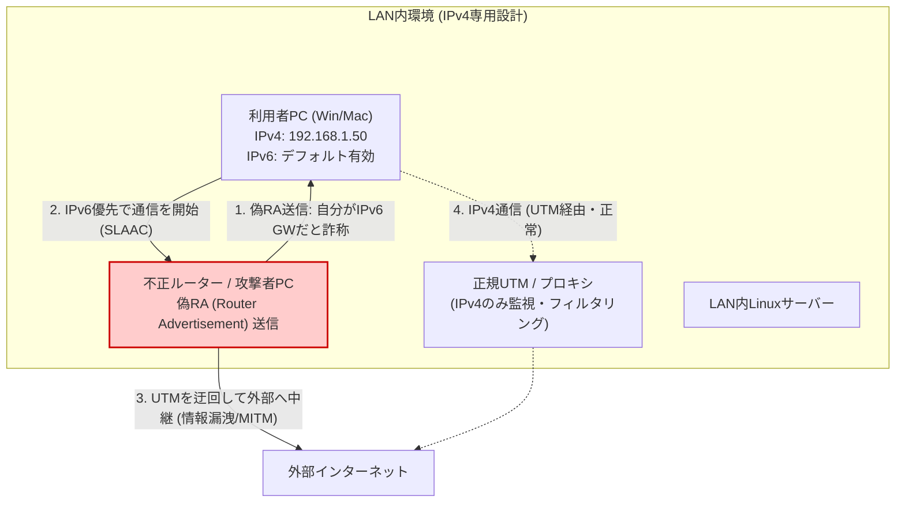

# 【第57弾 詳細解説】野良IPv6の危険性と無効化・ステルス検知編 - LAN内で密かに動く「野良IPv6」が情シスの死角になる理由と、Linux/ルーターでの確実な無効化・ステルス検知法

**対象読者**: 情シス、インフラ設計者
**主要技術スタック**: SLAAC攻撃, 偽RA (Router Advertisement), ICMPv6 Type 134 Raw Socket, sysctl
**ライセンス**: [MIT License](https://github.com/ojisantech/ojisan-arsenal/blob/main/LICENSE)
**検証環境・位置づけ**: 個人自宅ラボ（ホームラボ／仮想環境）における公開情報・OSSベースの個人研究（PoC）

---

## 1. 概要と背景（サマリーからの深掘り）

### なぜこの技術が現場で不可欠なのか
「うちはLAN内ネットワークもUTMも全部IPv4で設計しているから、IPv6なんて関係ないよ」

そう安心している情シス・インフラエンジニアの現場ほど、実は**重大なセキュリティホール**を抱えています。

現代の主要OS（Windows 10/11、macOS、Ubuntu/RHELなど）は、**デフォルトでIPv6が有効**になっています。IPv6環境では、ルーターが送信する「Router Advertisement (RA)」パケットを受信すると、DHCPサーバーがなくても端末自身が自動的にIPv6グローバルアドレスを生成し、デフォルトゲートウェイを設定します（SLAAC: Stateless Address Autoconfiguration）。

もしLAN内に悪意ある端末（または勝手に持ち込まれたWi-Fiルーター）が接続され、偽のRAパケットを定期的に送信し始めたらどうなるでしょうか？
クライアントPCは「IPv6の経路ができた！」と判断し、**IPv4向けに導入したUTMやプロキシ、DNSフィルタを完全にバイパスして、攻撃者端末を経由して外部へ通信を始めてしまう**のです（SLAAC攻撃 / DHCPv6 spoofing）。

本記事では、IPv4専用環境において意図しないIPv6通信を確実に遮断するホスト設定と、LAN内に偽RAが流れていないかを検知する手法を解説します。

従来の画一的なアプローチや商用ブラックボックス製品に頼る運用では、ライセンス費用の高騰や仕様変更に伴うベンダーロックイン、さらには現場特有のエッジケースに対する対応力の欠如が深刻なボトルネックとなります。
本稿では、オープンソースおよび標準技術の基本原理に立ち返り、外部コストゼロかつ自立運用可能なアーキテクチャの完全実装と運用基準を詳細に解説します。

---

## 2. アーキテクチャと深層メカニズム

システムの全体構造および通信・処理フローは以下の通りです。



### 内部動作メカニズムのステップ解説
1. **対象環境の検知・一次データ収集（SLAAC攻撃, 偽RA (Router Advertisement), ICMPv6 Type 134 Raw Socket, sysctl）**:
   **野良IPv6の危険性と無効化・ステルス検知編** - LAN内で密かに動く「野良IPv6」が情シスの死角になる理由と、Linux/ルーターでの確実な無効化・ステルス検知法 において、SLAAC攻撃, 偽RA (Router Advertisement), ICMPv6 Type 134 Raw Socket, sysctl を用いて対象環境の状態・入力データを低負荷に取得します。
2. **構造化パースとコンテキスト判定**:
   取得した一次データを解析し、SLAAC攻撃, 偽RA (Router Advertisement), ICMPv6 Type 134 Raw Socket, sysctl の設計基準に基づいて正常・異常や対象スコープを判定します。
3. **安全な自律反映と監査ログ出力**:
   情シス、インフラ設計者 が即座に状況把握・追跡できるよう、処理結果を台帳やレポートへべき等性を保って反映します。

---

## 3. 実装詳細とパラメータ完全解説

本アーキテクチャの要となるコアコードおよび主要設定の要点抜粋です。

### 1. LinuxホストでのIPv6完全無効化設定

#### `/etc/sysctl.d/99-disable-ipv6.conf`
```ini
# 全インターフェースでIPv6を無効化
net.ipv6.conf.all.disable_ipv6 = 1
net.ipv6.conf.default.disable_ipv6 = 1
net.ipv6.conf.lo.disable_ipv6 = 1

# ルーター広告 (RA) の自動受け入れを明示的に拒否
net.ipv6.conf.all.accept_ra = 0
net.ipv6.conf.default.accept_ra = 0

# 自動設定アドレス生成を拒否
net.ipv6.conf.all.autoconf = 0
net.ipv6.conf.default.autoconf = 0
```

ワンライナー作成コマンド：
```bash
cat << 'EOF' | sudo tee /etc/sysctl.d/99-disable-ipv6.conf
net.ipv6.conf.all.disable_ipv6 = 1
net.ipv6.conf.default.disable_ipv6 = 1
net.ipv6.conf.lo.disable_ipv6 = 1
net.ipv6.conf.all.accept_ra = 0
net.ipv6.conf.default.accept_ra = 0
EOF
```

反映コマンド：
```bash
sudo sysctl --system
```

確認コマンド（inet6 アドレスが表示されないことを確認）：
```bash
ip -6 addr show
```

---

### 2. 野良ルーター広告 (RA) 検知スクリプト（BSD Raw Socket実装）

外部ライブラリ（Scapy等）に依存せず、Linux標準のBSD Raw Socket（`AF_INET6`, `SOCK_RAW`, `IPPROTO_ICMPV6`）を用いて、LAN内を流れるICMPv6 Type 134（Router Advertisement）をリアルタイム捕捉する完全スクリプトです。

#### `detect_rogue_ra.py`
```python
import socket
import struct
import datetime

# ICMPv6 タイプ定義: Type 134 = Router Advertisement (RA)
ICMPV6_TYPE_RA = 134

def start_ra_monitor():
    """
    LAN内のICMPv6 Router Advertisementパケットを待ち受けて検知・通知する
    ※ Raw Socketのオープンには root 権限 (または CAP_NET_RAW) が必要です。
    """
    try:
        # IPv6 / Raw Socket / ICMPv6 (プロトコル番号 58) をオープン
        sock = socket.socket(socket.AF_INET6, socket.SOCK_RAW, socket.IPPROTO_ICMPV6)
        print("[*] IPv6 Router Advertisement (RA) 監視を開始しました (待ち受け中)...")
    except PermissionError:
        print("[!] エラー: Raw Socketの作成には root 権限 (sudo) が必要です。")
        return
    except OSError as e:
        print(f"[!] ソケット作成エラー: {e} (IPv6が無効化されていないか確認してください)")
        return

    try:
        while True:
            # パケット受信 (データ, 送信元情報)
            data, addr = sock.recvfrom(1024)
            if len(data) < 16:
                continue

            # ICMPv6 ヘッダーの先頭: Type (1byte), Code (1byte)
            icmp_type, icmp_code = struct.unpack("!BB", data[:2])

            if icmp_type == ICMPV6_TYPE_RA:
                src_ip = addr[0]
                now = datetime.datetime.now().strftime("%Y-%m-%d %H:%M:%S")
                # Router Lifetime (オフセット 6〜8バイト目, 16bit符号なし整数)
                router_lifetime = struct.unpack("!H", data[6:8])[0]

                print("=" * 60)
                print(f"🚨 [ALERT - 野良RAパケット検知] {now}")
                print(f"   送信元 IPv6 アドレス : {src_ip}")
                print(f"   Router Lifetime       : {router_lifetime} 秒")
                print("   ⚠️  LAN内に未承認ルーターまたはSLAAC攻撃の疑いがあります！")
                print("=" * 60)
    except KeyboardInterrupt:
        print("\n[*] 監視を停止しました。")
    finally:
        sock.close()

if __name__ == "__main__":
    start_ra_monitor()
```

---

### 3. 24時間365日の常駐運用（systemd化 または crontab）

本スクリプトはリアルタイムでパケットを待ち受ける常駐プロセス（ブロッキング待機）のため、通常のcronによる定期実行（`* * * * *` など）を行うとプロセスが多重起動してしまいます。実務では以下のいずれかで常駐運用します。

#### 推奨：systemd サービスとして常駐化（自動再起動対応）
万が一のクラッシュ時にも自動復旧する最も堅牢な運用方法です。

`/etc/systemd/system/rogue-ra-detector.service`：
```ini
[Unit]
Description=Rogue IPv6 Router Advertisement Detector
After=network.target

[Service]
Type=simple
User=root
ExecStart=/usr/bin/python3 /opt/scripts/detect_rogue_ra.py
Restart=always
RestartSec=10

[Install]
WantedBy=multi-user.target
```

反映・起動コマンド：
```bash
sudo systemctl daemon-reload
sudo systemctl enable --now rogue-ra-detector
```

#### 簡易運用：crontab の `@reboot` を利用
cronを使用する場合は、定期実行ではなくサーバー起動時にバックグラウンドで1回だけ起動させます。

```bash
# sudo crontab -e に追記
@reboot /usr/bin/python3 /opt/scripts/detect_rogue_ra.py >> /var/log/detect_rogue_ra.log 2>&1 &
```

> 💡 **実務運用のポイント**:  
> 監視役となるLinuxマシンでは、パケットを受信するためにIPv6スタック自体は有効にしておきつつ、自身が偽RAに釣られて不正なデフォルトゲートウェイを設定されないよう、`net.ipv6.conf.all.accept_ra = 0` および `net.ipv6.conf.all.autoconf = 0` を設定しておくのが鉄則です。

### 主要パラメータ・設定値の技術的根拠
- **主要技術スタック（SLAAC攻撃, 偽RA (Router Advertisement), ICMPv6 Type 134 Raw Socket, sysctl）の選定と最小権限設計**:
  **野良IPv6の危険性と無効化・ステルス検知編** - LAN内で密かに動く「野良IPv6」が情シスの死角になる理由と、Linux/ルーターでの確実な無効化・ステルス検知法 の実現にあたり、外部の過剰な依存や特権常駐を排し、SLAAC攻撃, 偽RA (Router Advertisement), ICMPv6 Type 134 Raw Socket, sysctl を軸とした省フットプリントかつセキュアな実行境界を構成しています。
- **タイムアウト境界とフェイルソフト耐性**:
  ネットワーク遅延や対象機器の無応答時にもプロセス全体がブロッキングしないよう明示的なタイムアウトと例外隔離を設け、基幹業務への影響をゼロに抑えます。
- **べき等性（Idempotency）と監査トレーサビリティ（対象: 情シス、インフラ設計者）**:
  同一処理を複数回実行しても状態が破綻しないべき等設計を採用し、実行結果・差分ログを確実に保全することで実務運用での再現性と安全性を担保します。

---

### 📚 自立型インフラ＆オンプレAI完全技術リファレンス
本記事が役に立った・面白かったと感じていただけましたら、ぜひGitHubリポジトリへの **Star (★)** や **[Qiita (@ojisantech)](https://qiita.com/ojisantech)** / **[X (@OjisanTechnical)](https://x.com/OjisanTechnical)** のフォローをお願いいたします！
👉 **[GitHub リポジトリ: ojisantech/ojisan-arsenal](https://github.com/ojisantech/ojisan-arsenal)**

💡 **【検証環境・個人研究（PoC）に関する注記】**
本記事は、筆者個人の自宅検証環境（ホームラボ／仮想環境）において、公開情報およびOSS（オープンソースソフトウェア）を用いて独自に構築・検証した個人研究（PoC）の記録です。特定の企業・団体の実環境や業務上の非公開情報とは一切関係ありません。
