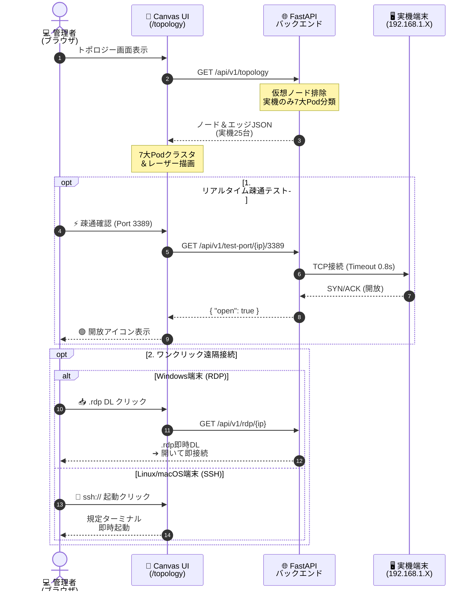

# 【第6弾 詳細解説】100%実機トポロジー ＆ ワンクリック遠隔接続編 - 「仮想ゴミノードで画面が埋まる…」にサヨナラ。HTML5 Canvasで実機100%の7大分類トポロジーを描画し、ワンクリックでRDP/SSH接続するハブを作った話【個人検証PoC】

> **対象読者**: インフラエンジニア、運用監視担当  
> **主要技術スタック**: FastAPI, HTML5 Canvas 2D, 動的RDP生成, TCP Socket  
> **ライセンス**: [MIT License](https://github.com/ojisantech/ojisan-arsenal/blob/main/LICENSE)  
> **検証環境・位置づけ**: 個人自宅ラボ（ホームラボ／仮想環境）における公開情報・OSSベースの個人研究（PoC）  


> 💡 **【検証環境・個人研究（PoC）に関する注記】**  
> 本記事は、筆者個人の自宅検証環境（ホームラボ／仮想環境）において、公開情報およびOSS（オープンソースソフトウェア）を用いて独自に構築・検証した個人研究（PoC）の記録です。特定の企業・団体の実環境や業務上の非公開情報とは一切関係ありません。

---

## 1. 概要と背景（サマリーからの深掘り）

### 既存のネットワークマップに感じる「3つのこれじゃない感」
インフラエンジニアや運用担当者であれば、一度はネットワークの自動可視化マップを導入・検討したことがあるはずです。しかし、一般的な監視ツールのトポロジーマップを実運用に乗せると、以下の3つの壁に直面しがちです。

1. **仮想IPやDockerブリッジ、一時的なゴミノードが大量に描画されて画面が埋まる**:  
   単純なARP/Pingスキャン結果をそのままマップ化すると、`docker0`、`veth`、WSL仮想NIC、マルチキャストアドレスなどの「物理実体のないノイズ」が数十個も並び、本当に監視したい実機がどこにあるのか判別できなくなります。
2. **ノードをクリックしても「グラフ」が出るだけで、そこから直接ログイン（RDP/SSH）できない**:  
   障害発生時にマップ上で赤いノードを見つけても、結局そこからIPアドレスをコピーして別アプリの「リモートデスクトップ接続」やターミナルを手動で立ち上げて打ち直す手間が発生します。
3. **重いSVGやDOM要素を何百個も並べてブラウザがフリーズする**:  
   ノード数が増えるにつれてDOMツリーが肥大化し、拡大縮小（ズーム）やドラッグ移動（パン）のたびに描画がカクつきます。

運用者が本当に欲しいのは、**「LAN内に物理的に存在する実機だけが用途別に整理されたマップ」** であり、**「画面上のノードから事前疎通確認のうえワンクリックでRDP/SSH/VNC接続を起動できる運用ハブ」** です。本稿では、その設計と完全な実装コード（FastAPIバックエンド＋HTML5 Canvas 2Dフロントエンド）を解説します。

---

## 2. アーキテクチャと深層メカニズム

### トポロジー描画・リアルタイム疎通検証・ワンクリック遠隔接続の全体シーケンス



### 仮想ゴミノードを徹底排除する「実機100%・7大分類Pod」構造

単なるスター型配線図ではノードが重なって視認性が落ちるため、MACアドレスのOUI、開放ポート（5985/3389/22/631/5353等）、OSフィンガープリントに基づき、仮想インターフェースを除外した上で以下の**7つの業務Pod（クラスタ）**へ自動分類してレイアウト計算を行います。

```text
                   [ 🌐 ゲートウェイ (ルーター) ]
                                 │
   ┌──────────┬──────────┬───────┴──────┬──────────┬──────────┬──────────┐
   ▼          ▼          ▼              ▼          ▼          ▼          ▼
 [Pod 1]    [Pod 2]    [Pod 3]        [Pod 4]    [Pod 5]    [Pod 6]    [Pod 7]
ルーターGW  Linuxサーバー NASストレージ  クライアントPC プリンタ複合機 スマホ端末    スマートIoT
 (Netgear)  (Ubuntu)   (Synology)     (Win/Mac)  (Epson)    (iPhone)   (Echo/TV)
```

### 内部動作メカニズムの4ステップ解説
1. **仮想インターフェース排除と7大Pod自動分類**:
   Docker内部サブネット（`172.17.0.0/16` 等）、ループバック、マルチキャスト、および応答のないゴーストARPエントリを除外します。生存実機のみを開放ポートとOUI辞書から7つのPodカテゴリに自動振り分けします。
2. **短タイムアウト（0.8秒）リアルタイム・ポートチェッカー**:
   リモート接続ボタンを押す前に、バックエンドから対象IP・ポート（RDP: `3389`, SSH: `22`, VNC: `5900`, HTTP: `80/443`）へ `0.8秒` タイムアウトのTCPソケット接続を行い、今この瞬間にポートが開いているかをミリ秒単位でUIへフィードバックします。
3. **動的 `.rdp` ストリーミング生成とURIスキーム連携**:
   ブラウザのセキュリティサンドボックス制約により、Webページから直接ローカルの `mstsc.exe` を引数付きで起動することはできません。そこでFastAPIが対象IPと最適化パラメータ（Smart Sizing、クリップボード共有等）を埋め込んだ `application/x-rdp` ストリームを動的生成して返却し、ワンクリックでのRDP起動を実現します（SSH/VNCは `ssh://user@ip` / `vnc://ip` カスタムURIスキームで起動）。
4. **DOMレス・HTML5 Canvas 2D による60fps高速レンダリング**:
   数百個のSVG/DOM要素を生成する代わりに、単一の `<canvas>` コンテキスト上でベジェ曲線・点線レーザー・状態リングを直接描画することで、メモリ消費を最小化し滑らかなパン＆ズーム操作を実現します。

---

## 3. 実装詳細とパラメータ完全解説

本アーキテクチャの核となる3つの実装コード（FastAPI `.rdp` 動的生成エンドポイント、0.8秒リアルタイムTCPポートチェッカー、HTML5 Canvas 2D レンダリングエンジン）の完全版です。

### 1. FastAPI：ワンクリック接続用 `.rdp` ファイル動的生成エンドポイント

毎回リモートデスクトップクライアントを開いてIPアドレスや画面サイズを入力する手間をゼロにするため、対象IPと実務最適設定を埋め込んだ `.rdp` 設定ファイルをメモリ上で動的生成し、ダウンロードレスポンスとして返却します。

```python
import ipaddress
from fastapi import FastAPI, HTTPException, Response

app = FastAPI()

@app.get("/api/v1/rdp/{ip}")
def generate_rdp_file(ip: str) -> Response:
    """
    対象IPアドレスを厳密にバリデーションした上で、
    最適化済みの .rdp 設定ファイルを動的ストリーミング生成する。
    """
    # インジェクション防止のためIPアドレス形式を厳格に検証
    try:
        valid_ip = str(ipaddress.ip_address(ip))
    except ValueError:
        raise HTTPException(status_code=400, detail="Invalid IP address format")

    rdp_content = "\r\n".join([
        f"full address:s:{valid_ip}:3389",
        "prompt for credentials:i:1",
        "administrative session:i:1",
        "screen mode id:i:2",
        "use multimon:i:0",
        "desktopwidth:i:1920",
        "desktopheight:i:1080",
        "session bpp:i:32",
        "compression:i:1",
        "keyboardhook:i:2",
        "audiocapturemode:i:0",
        "videoplaybackmode:i:1",
        "connection type:i:6",
        "displayconnectionbar:i:1",
        "disable wallpaper:i:0",
        "allow font smoothing:i:1",
        "allow desktop composition:i:1",
        "disable full window drag:i:1",
        "disable menu anims:i:1",
        "disable themes:i:0",
        "disable cursor setting:i:0",
        "bitmapcachepersistenable:i:1",
        "redirectclipboard:i:1",
        "redirectprinters:i:0",
        "redirectcomports:i:0",
        "redirectsmartcards:i:0",
        "redirectposdevices:i:0",
        "autoreconnection enabled:i:1",
        "authentication level:i:2",
        "smart sizing:i:1",
        ""
    ])

    safe_filename = f"connect_{valid_ip.replace('.', '_')}.rdp"
    headers = {
        "Content-Disposition": f'attachment; filename="{safe_filename}"',
        "Cache-Control": "no-store"
    }
    return Response(
        content=rdp_content,
        media_type="application/x-rdp",
        headers=headers
    )
```

### 2. FastAPI：接続前の無駄なタイムアウト待ちをなくす「0.8秒TCPポートチェッカー」

「RDPファイルを開いたのに、相手の電源が落ちていて30秒間黒い画面で待たされる」というストレスを防ぐため、UIのモーダルを開いた瞬間に0.8秒でポート開放状態を判定するAPIです。

```python
import ipaddress
import socket
from fastapi import FastAPI, HTTPException

@app.get("/api/v1/test-port/{ip}/{port}")
def test_port_connectivity(ip: str, port: int) -> dict:
    """
    対象IP・ポートのTCP LISTEN状態を短タイムアウト（0.8秒）で即時判定する
    """
    try:
        valid_ip = str(ipaddress.ip_address(ip))
    except ValueError:
        raise HTTPException(status_code=400, detail="Invalid IP address")

    if not (1 <= port <= 65535):
        raise HTTPException(status_code=400, detail="Invalid port range")

    sock = socket.socket(socket.AF_INET, socket.SOCK_STREAM)
    sock.settimeout(0.8)
    try:
        result = sock.connect_ex((valid_ip, port))
        is_open = (result == 0)
    except Exception:
        is_open = False
    finally:
        sock.close()

    return {"ip": valid_ip, "port": port, "open": is_open}
```

### 3. JavaScript：DOMを使わず60fpsで描画する HTML5 Canvas 2D トポロジーエンジン

SVGタグやDOMノードを使わず、Canvas 2Dコンテキスト上にエッジ（接続レーザー線）と実機ノード（オンライン緑リング／脆弱性アラート赤リング）を一括描画するフロントエンドコア実装です。

```javascript
/**
 * HTML5 Canvas 2D による実機トポロジー描画コア
 * @param {CanvasRenderingContext2D} ctx
 * @param {Array<{x:number, y:number, label:string, ip:string, hasAlert:boolean}>} nodes
 * @param {Array<{source:{x:number, y:number}, target:{x:number, y:number}}>} edges
 */
function drawTopology(ctx, nodes, edges) {
    const canvas = ctx.canvas;
    ctx.clearRect(0, 0, canvas.width, canvas.height);

    // 1. ゲートウェイと各Pod実機ノードを繋ぐ接続レーザー線の描画
    edges.forEach(edge => {
        ctx.beginPath();
        ctx.strokeStyle = "rgba(0, 229, 255, 0.4)";
        ctx.lineWidth = 1.5;
        ctx.setLineDash([4, 2]); // 点線レーザー表現
        ctx.moveTo(edge.source.x, edge.source.y);
        ctx.lineTo(edge.target.x, edge.target.y);
        ctx.stroke();
    });

    // 2. 実機ノードおよび状態リングの描画
    nodes.forEach(node => {
        // ノード背景円
        ctx.fillStyle = "#1e293b";
        ctx.beginPath();
        ctx.arc(node.x, node.y, 24, 0, Math.PI * 2);
        ctx.fill();

        // ステータスリング（🔴 未対応CVEあり / 🟢 正常オンライン）
        ctx.strokeStyle = node.hasAlert ? "#ef4444" : "#10b981";
        ctx.lineWidth = 3;
        ctx.setLineDash([]);
        ctx.stroke();

        // ホスト名ラベル描画
        ctx.fillStyle = "#f8fafc";
        ctx.font = "12px Inter, sans-serif";
        ctx.textAlign = "center";
        ctx.fillText(node.label, node.x, node.y + 38);

        // IPアドレス描画（等幅フォント）
        ctx.fillStyle = "#94a3b8";
        ctx.font = "10px monospace";
        ctx.fillText(node.ip, node.x, node.y + 52);
    });
}
```

### 主要パラメータ・設定値の技術的根拠

| パラメータ / 設定項目 | 推奨設定値 | 技術的根拠・設計意図 |
| :--- | :--- | :--- |
| **`.rdp` パラメータ `smart sizing:i:1`** | 有効 (`1`) | リモートデスクトップのウィンドウを手元PCの画面サイズに合わせてドラッグ拡縮した際、スクロールバーを出さずにアスペクト比を維持して綺麗に縮小表示させる必須オプション。 |
| **`.rdp` パラメータ `redirectclipboard:i:1` / `redirectprinters:i:0`** | クリップボードのみ有効 | パスワードやコマンドのコピー＆ペーストは許可しつつ、ローカルプリンタやCOMポート、スマートカードの意図しないリダイレクトによる情報漏洩・ドライバ汚染を遮断する。 |
| **ポートチェック `settimeout(0.8)`** | `0.8` 秒 | 同一LAN内の正常なTCP 3ウェイ・ハンドシェイクは数ミリ秒〜数十ミリ秒で完了するため、0.8秒応答がなければ即座に「閉鎖/オフライン」と判定してUIの体感速度を高める。 |
| **MIMEタイプ `application/x-rdp`** | `Content-Disposition: attachment` | Windows/macOSの主要ブラウザにおいてテキスト表示させず、OS既定のRDPクライアント（`mstsc.exe` / Windows App）へ直接関連付け起動させる標準ヘッダ。 |

---

## 4. 現場運用・アンチパターンと回避策

1. **`.rdp` ファイルへの平文パスワード埋め込み禁止**: `.rdp` 生成APIには絶対にパスワードを含めず、`prompt for credentials:i:1` を指定して接続時にOSの資格情報マネージャーまたは手動入力を求めること。
2. **ポートチェッカーAPIのSSRF（Server-Side Request Forgery）対策**: `/api/v1/test-port/{ip}/{port}` に対して任意の外部グローバルIPやループバックを指定されないよう、許可サブネット（RFC1918プライベートアドレスまたは台帳登録済みIP）のみに制限すること。

### 避けるべきアンチパターン
- **アンチパターン1：Dockerブリッジや仮想NICをフィルタせずにそのまま描画する**  
  コンテナホストや開発機をスキャンした際、`172.17.x.x`〜`172.31.x.x` や仮想MACアドレス（`02:42:ac:...` 等）を実機と同列にマップ描画すると、画面の半分が仮想ブリッジで埋め尽くされます。OUIおよびサブネットマスクのホワイトリストで「物理実機（および明示的な管理対象VM）」のみを抽出してください。
- **アンチパターン2：IPパラメータをサニタイズせずに `.rdp` 文字列へ直接展開する（CRLFインジェクション）**  
  `ip` パラメータに改行コード（`\r\n`）や不正な `.rdp` ディレクティブ（例：`alternate shell:s:cmd.exe` 等）を混入されると、ダウンロードした管理者PC上で意図しない設定が実行されるリスクがあります。必ず `ipaddress.ip_address(ip)` で厳密にIPアドレス型としてパース・検証してから埋め込んでください。
- **アンチパターン3：高DPI（Retina / 4K）ディスプレイで `devicePixelRatio` を無視してCanvas描画する**  
  `canvas.width` とCSSサイズの比率を `window.devicePixelRatio` でスケーリングしないと、高解像度モニターで文字やアイコンがぼやけて視認性が低下します。初期化時に `ctx.scale(dpr, dpr)` を適用してください。

---

## 5. トラブルシューティングガイド

障害発生時の一次切り分けフローおよび確認コマンド一覧です。

| 障害事象・エラーメッセージ | 想定原因 | 一次切り分け・復旧コマンド |
| :--- | :--- | :--- |
| **`ssh://` リンクをクリックしてもターミナルが起動しない** | クライアントOS側で `ssh://` URIスキームの関連付けハンドラが未登録 | Windows Terminal / iTerm2 / PuTTY 等の設定で `ssh://` プロトコルハンドラを登録する |
| **`.rdp` ダウンロード時にブラウザで「安全でないダウンロード」と警告される** | ダッシュボード自体を平文HTTP（非HTTPS）で開いている場合のブラウザ保護機能 | 内部リバースプロキシ（Caddy / Nginx）で自己署名または内部CA証明書によるHTTPS化を行う |
| **ポートチェックで `3389` は 🟢 Open なのにRDP接続時に認証エラーになる** | 対象Windows側のNLA（ネットワークレベル認証）要求と資格情報不一致 | `.rdp` 内の `authentication level:i:2` およびドメイン名プレフィックス（`.\username` 等）を確認 |
| **Canvas上のノードをクリックしても別ノードが選択される** | キャンバスのズーム・パン変換行列（Transform）とマウスクリック座標の逆変換ズレ | `getBoundingClientRect()` から取得した座標に対し、現在の `panOffset` と `zoomScale` の逆演算を適用してヒットテストを行う |

---

## 6. 実務FAQ（よくある質問と回答）

**Q1: なぜWebブラウザ内完結のHTML5 RDP/SSHクライアント（Apache Guacamole等）ではなく、ネイティブアプリ起動方式にしたのですか？**  
**A1**: Guacamole等の踏み台ゲートウェイは非常に便利ですが、常時稼働する中継デーモン（`guacd`）の構築・保守コストや、Webブラウザ経由での日本語入力・ショートカットキー競合・マルチモニター解像度劣化といった課題があります。`.rdp` 動的生成や `ssh://` スキーム方式であれば、中継サーバーの負荷はゼロで、OS標準の最高性能なネイティブクライアントをワンクリックで呼び出せます。

**Q2: 7大分類Podのどこにも当てはまらない未知の機器はどう表示されますか？**  
**A2**: 仮想インターフェースやブロードキャスト等のノイズを除外した上で、どうしてもOUIやポートから種別が特定できない実機が存在する場合は、第7のPod（スマートIoT／未分類実機クラスタ）に配置して「要確認ノード」としてハイライト表示します。

**Q3: ノード数が100台〜500台に増えた場合でもCanvas描画は重くなりませんか？**  
**A3**: HTML5 Canvas 2Dのプリミティブ描画（円と線とテキスト）はGPUアクセラレーションが効くため、500ノード程度であれば1フレームあたり2〜3ミリ秒（60fps維持）で余裕をもって描画可能です。

---

## 7. 本番適用チェックリスト

- [ ] `/api/v1/rdp/{ip}` および `/api/v1/test-port/{ip}/{port}` で `ipaddress.ip_address()` による入力値検証が実装されているか
- [ ] ポートチェックAPIの接続先が管理対象プライベートサブネットのみに制限されているか（SSRF防止）
- [ ] Dockerブリッジ（`172.17.0.0/16` 等）やループバック・マルチキャストIPがトポロジー抽出クエリから除外されているか
- [ ] 生成される `.rdp` ファイルにパスワードが含まれておらず、プリンタやスマートカードの不要なリダイレクトが無効（`0`）になっているか
- [ ] 高解像度ディスプレイ対応（`window.devicePixelRatio` スケーリング）がCanvas初期化処理に組み込まれているか

---

## 8. ライセンス・著作権表示

本稿に掲載されているアーキテクチャ図、処理フロー、およびコード抜粋・スニペットは、[MIT License](https://github.com/ojisantech/ojisan-arsenal/blob/main/LICENSE) の下で公開されています。商用・非商用問わず自由にご利用・ご参照いただけますが、著作権表示および許諾表示の保持が必要です。

```text
MIT License

Copyright (c) 2026 ojisantech
```

