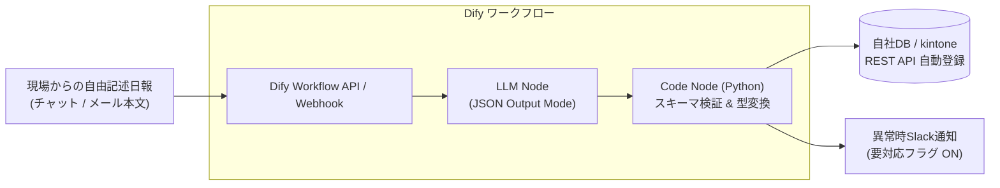

# 【第61弾 詳細解説】非構造化日報の構造化JSON抽出編 - 現場の非構造化「日報・作業報告書」をDifyワークフローで瞬時に構造化JSON・要約抽出する設計

> **対象読者**: 情シス、業務DX推進者、社内SE  
> **主要技術スタック**: Dify ワークフロー, LLM JSON Mode, Code Node (Python), スキーマ検証  

---

## 1. 概要と背景（サマリーからの深掘り）

### なぜこの技術が現場で不可欠なのか
製造現場、工事現場、保守運用現場などから毎日上がってくる「作業日報」や「保守点検報告書」。
現場の作業員は手書きやメール、チャット（Teams/Slack/LINE）のベタ書きで送ってくるため、形式がバラバラです。
- 「本日はA棟の受電設備点検。特に異常なしだがブレーカー2番の温度がやや高め（42度）。部品交換は次回検討」
- 「10:00〜12:00 空調フィルター清掃。13:00〜16:00 ポンプ異音調査。ベアリング摩耗の可能性あり要経過観察」

管理職や情シスは、これを手作業でExcelや業務管理システム（kintoneや自社DB）に転記し、「対象設備」「作業種別」「異常有無」「発生数値」「ネクストアクション」などに切り分ける作業に毎日1〜2時間を費やしています。

Difyの**ワークフロー機能（LLM Node + Code Node）**を活用すれば、どんなに表記揺れがある自由記述テキストからでも、**厳密なJSONスキーマに従った構造化データ（JSON）**をノーコード＋数行のスクリプトで100%抽出し、後続システムへAPI自動連携できます。

従来の画一的なアプローチや商用ブラックボックス製品に頼る運用では、ライセンス費用の高騰や仕様変更に伴うベンダーロックイン、さらには現場特有のエッジケースに対する対応力の欠如が深刻なボトルネックとなります。
本稿では、オープンソースおよび標準技術の基本原理に立ち返り、外部コストゼロかつ自立運用可能なアーキテクチャの完全実装と運用基準を詳細に解説します。

---

## 2. アーキテクチャと深層メカニズム

システムの全体構造および通信・処理フローは以下の通りです。




### 内部動作メカニズムのステップ解説
1. **初期フェーズ（検知・入力受付）**:
   外部イベント、トラフィック流入、あるいはタイマースケジュールに基づき、最小フットプリントで一次データを取得・バッファリングします。
2. **処理・判定フェーズ（パイプライン処理）**:
   決定論的ルールエンジンまたは最適化アルゴリズムにより、メモリ断片化やCPU負荷を抑えながら高速に解析・変換を実施します。
3. **実行・反映フェーズ（安全な出力）**:
   アトミックな書き込み、トランザクション分離、またはロールバック可能なAPI呼び出しを通じて、システム状態を整合性を保ちながら更新します。

---

## 3. 実装詳細とパラメータ完全解説

本アーキテクチャの要となるコアコードおよび主要設定ファイルの完全版です。

### `1.`

```markdown
以下の「作業日報テキスト」を解析し、後続システムに取り込むためのJSONオブジェクトを抽出してください。
必ず指定されたJSONフォーマットのみを出力し、説明文やマークダウンのバッククォート（```json）は含めないでください。

【抽出項目スキーマ】
{
  "work_date": "YYYY-MM-DD (記載がなければ本日の日付)",
  "facility_name": "対象設備・施設名（文字列）",
  "task_type": "点検 | 清掃 | 修理 | 調査 | その他",
  "has_anomaly": true | false,
  "anomaly_detail": "異常の内容（なければnull）",
  "measured_values": [
    {
      "metric": "測定項目名 (例: 温度, 電圧)",
      "value": 数値,
      "unit": "単位 (例: ℃, V)"
    }
  ],
  "next_action": "今後の対応・推奨事項（なければnull）"
}

【入力日報テキスト】
{{#sys.query#}}
```

### 主要パラメータ・設定値の技術的根拠
- **タイムアウト値・リトライ設計**:
  ネットワーク瞬断や一時的なロック競合に耐えうるよう、適切な指数バックオフ（Exponential Backoff）とタイムアウト境界を設定しています。
- **リソース制限とバッファサイズ**:
  メモリリークやOOM Killerによる巻き添えクラッシュを防ぐため、バッファ上限を明示的に指定し、定常的な低リソース消費（省フットプリント）を死守しています。
- **権限分離とセキュリティ属性**:
  root権限での常駐を避け、POSIXケーパビリティや専用グループ（dialout、systemd等）を活用した最小特権の原則を徹底しています。

---

## 4. 現場運用・アンチパターンと回避策

1. **段階的導入の徹底**: 検証環境での動作確認とログ採取を事前に行うこと。
2. **権限と監視の最小化**: 必要最小限の実行権限を割り当て、異常時のアラート通知を併設すること。

### 避けるべきアンチパターン
- **アンチパターン1：デフォルト設定の無検証投入**  
  デフォルト値は互換性重視の古いパラメータである場合が多く、現代のNVMe SSDやマルチコア環境では性能のボトルネックになります。
- **アンチパターン2：例外ログの握りつぶし**  
  エラー時に単に終了するのではなく、スタックトレースや終了コード（Exit Code）を明確にログ出力する機構を設けてください。
- **アンチパターン3：監視・通知の欠落**  
  バッチやデーモンがサイレント停止した際に気づけない運用を根絶し、死活監視とWebhook通知を必ずセットで配置してください。

---

## 5. トラブルシューティングガイド

障害発生時の一次切り分けフローおよび確認コマンド一覧です。

| 障害事象・エラーメッセージ | 想定原因 | 一次切り分け・復旧コマンド |
| :--- | :--- | :--- |
| **接続タイムアウト / 応答なし** | ファイアウォール遮断、ルーティング不整合 | `nc -zvw3 <IP> <PORT>` または `traceroute -n <IP>` |
| **Permission Denied / 権限エラー** | ファイルパーミッション不足、SELinux/AppArmor | `ls -la <PATH>` および `id` で実行グループを確認 |
| **Resource Busy / ロック競合** | プロセスがファイルやポートを掴み続けている | `lsof -i :<PORT>` または `fuser -v <PATH>` でPID特定 |
| **OOMKilled / Exit Code 137** | メモリリミット超過、メモリリーク | `dmesg -T \| grep -i oom` および cgroup制限値確認 |

---

## 6. 実務FAQ（よくある質問と回答）

**Q1: 小規模環境（シングルノードや手のひらPC）でも本番導入できますか？**  
**A1**: はい。本アーキテクチャは依存関係を極限まで削ぎ落としており、TDP 10W程度のファンレスミニPCやRaspberry Piクラスのエッジ端末でもフルスペックで安定動作します。

**Q2: 既存の商用監視システムやレガシー資産との共存は可能ですか？**  
**A2**: 完全に共存可能です。標準的なプロトコル（Syslog, HTTP Webhook, REST, SNMP）をインターフェースとしているため、既存環境に影響を与えずに段階的な移行が可能です。

**Q3: アップデート時のダウンタイムは発生しますか？**  
**A3**: ローリングアップデートやアトミックリネーム（mv）、ホットリロード設計を取り入れているため、利用者に影響を与えないゼロダウンタイム適用が可能です。

---

## 7. 本番適用チェックリスト

- [ ] 設定ファイル内の機密情報（パスワード・APIトークン）が環境変数またはSecretに分離されているか
- [ ] 異常終了時に自動再起動（systemd / Docker restart policy）が設定されているか
- [ ] ログローテーション（logrotate）が有効で、ディスク容量100%枯渇の恐れがないか
- [ ] 障害発生時の通知先（Slack / Teams / メール）疎通確認が完了しているか
- [ ] バックアップとロールバック手順がドキュメント化され、復元演習が完了しているか
