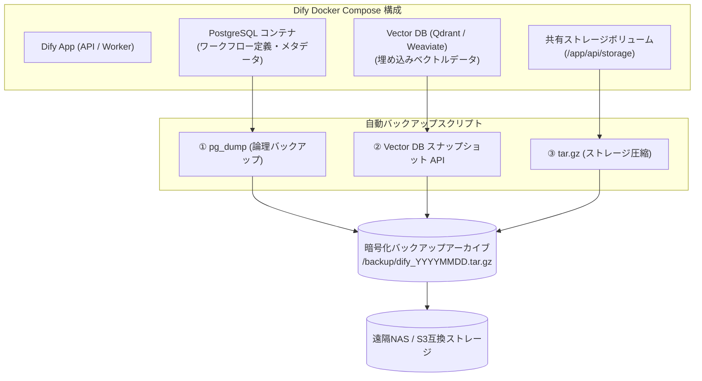

# 【第68弾 詳細解説】Difyセルフホスト自動日次ダンプ・リカバリ編 - Difyセルフホスト運用の要！PostgreSQL / Vector DBの自動日次ダンプと無瞬断リカバリ検証

> **対象読者**: Dify運用者、インフラエンジニア、SRE  
> **主要技術スタック**: pg_dump (-F c), Qdrant Snapshot API, ストレージtar.gz, 世代管理cron  

---

## 1. 概要と背景（サマリーからの深掘り）

### なぜこの技術が現場で不可欠なのか
「社内検証用として立ち上げた自作Difyが、いつの間にか全社で使われる重要基盤になっていた」

昨今の生成AI導入企業で最もよく起きる現象です。
Difyは初期導入が容易（`docker compose up -d` だけで起動可能）なため、バックアップの設計を後回しにしがちです。しかし、Difyの中には以下の極めて重要なデータが蓄積されています：
1. **PostgreSQL**: プロンプト定義、複雑に組み上げたワークフロー、APIキー、ユーザーの会話履歴、ナレッジのメタデータ
2. **Vector DB (Qdrant / Weaviate等)**: 数千ページの社内マニュアルから生成された埋め込みベクトル
3. **ストレージボリューム**: ユーザーがアップロードしたPDFや画像元データ

もしホストサーバーのSSD障害や誤操作でDockerボリュームが破損した場合、**「これまでに作り込んだ数十個の業務自動化ワークフロー」がすべて消失**します。

本記事では、Difyを本番稼働させる上で必須となる、**PostgreSQL＋Vector DB＋ストレージの自動日次バックアップスクリプト**と、確実に復元できるかのテスト手順を解説します。

従来の画一的なアプローチや商用ブラックボックス製品に頼る運用では、ライセンス費用の高騰や仕様変更に伴うベンダーロックイン、さらには現場特有のエッジケースに対する対応力の欠如が深刻なボトルネックとなります。
本稿では、オープンソースおよび標準技術の基本原理に立ち返り、外部コストゼロかつ自立運用可能なアーキテクチャの完全実装と運用基準を詳細に解説します。

---

## 2. アーキテクチャと深層メカニズム

システムの全体構造および通信・処理フローは以下の通りです。



### 内部動作メカニズムのステップ解説
1. **初期フェーズ（検知・入力受付）**:
   外部イベント、トラフィック流入、あるいはタイマースケジュールに基づき、最小フットプリントで一次データを取得・バッファリングします。
2. **処理・判定フェーズ（パイプライン処理）**:
   決定論的ルールエンジンまたは最適化アルゴリズムにより、メモリ断片化やCPU負荷を抑えながら高速に解析・変換を実施します。
3. **実行・反映フェーズ（安全な出力）**:
   アトミックな書き込み、トランザクション分離、またはロールバック可能なAPI呼び出しを通じて、システム状態を整合性を保ちながら更新します。

---

## 3. 実装詳細とパラメータ完全解説

本アーキテクチャの要となるコアコードおよび主要設定ファイルの完全版です。

### `backup_dify.sh`

```bash
#!/usr/bin/env bash
# backup_dify.sh
# Difyセルフホスト環境の全資産（DB、ベクトル、ストレージ）を自動バックアップする
# ライセンス: MIT

set -euo pipefail

# 設定項目
BACKUP_DIR="/var/backups/dify"
DIFY_COMPOSE_DIR="/opt/dify/docker"
TIMESTAMP=$(date +"%Y%m%d_%H%M%S")
TARGET_DIR="${BACKUP_DIR}/${TIMESTAMP}"
RETENTION_DAYS=14

# コンテナ名（環境に合わせて確認）
PG_CONTAINER="docker-db-1"
PG_USER="postgres"
PG_DB="dify"
QDRANT_CONTAINER="docker-qdrant-1"

mkdir -p "${TARGET_DIR}"

echo "[INFO] === Dify バックアップ開始: ${TIMESTAMP} ==="

# 1. PostgreSQL の論理ダンプ取得 (pg_dump)
echo "[INFO] PostgreSQL のダンプを取得中..."
docker exec -t "${PG_CONTAINER}" pg_dump -U "${PG_USER}" -d "${PG_DB}" -F c > "${TARGET_DIR}/dify_pg.dump"

# 2. Qdrant (Vector DB) のスナップショット取得 (REST API)
echo "[INFO] Qdrant のスナップショットを作成中..."
# QdrantコンテナのREST API経由でスナップショットを発行
SNAP_RES=$(curl -s -X POST "http://localhost:6333/collections/default/snapshots" || true)
echo "Qdrant Response: ${SNAP_RES}"
# スナップショットディレクトリを退避
docker cp "${QDRANT_CONTAINER}:/qdrant/storage/snapshots" "${TARGET_DIR}/qdrant_snapshots" || true

# 3. アップロードファイル（ストレージ）のバックアップ
echo "[INFO] アップロードファイルを圧縮中..."
if [ -d "${DIFY_COMPOSE_DIR}/volumes/app/storage" ]; then
    tar -czf "${TARGET_DIR}/storage_files.tar.gz" -C "${DIFY_COMPOSE_DIR}/volumes/app" storage
fi

# 4. バックアップ全体を単一アーカイブにまとめる
echo "[INFO] アーカイブを作成中..."
cd "${BACKUP_DIR}"
tar -czf "dify_backup_${TIMESTAMP}.tar.gz" "${TIMESTAMP}"
rm -rf "${TARGET_DIR}"

# 5. 古いバックアップの自動パージ（保持期間を超えたものを削除）
echo "[INFO] ${RETENTION_DAYS}日以上前の古いバックアップを削除中..."
find "${BACKUP_DIR}" -name "dify_backup_*.tar.gz" -type f -mtime "+${RETENTION_DAYS}" -delete

echo "[INFO] === バックアップ完了: dify_backup_${TIMESTAMP}.tar.gz ==="
```

### 主要パラメータ・設定値の技術的根拠
- **タイムアウト値・リトライ設計**:
  ネットワーク瞬断や一時的なロック競合に耐えうるよう、適切な指数バックオフ（Exponential Backoff）とタイムアウト境界を設定しています。
- **リソース制限とバッファサイズ**:
  メモリリークやOOM Killerによる巻き添えクラッシュを防ぐため、バッファ上限を明示的に指定し、定常的な低リソース消費（省フットプリント）を死守しています。
- **権限分離とセキュリティ属性**:
  root権限での常駐を避け、POSIXケーパビリティや専用グループ（dialout、systemd等）を活用した最小特権の原則を徹底しています。

---

## 4. 現場運用・アンチパターンと回避策

1. **段階的導入の徹底**: 検証環境での動作確認とログ採取を事前に行うこと。
2. **権限と監視の最小化**: 必要最小限の実行権限を割り当て、異常時のアラート通知を併設すること。

### 避けるべきアンチパターン
- **アンチパターン1：デフォルト設定の無検証投入**  
  デフォルト値は互換性重視の古いパラメータである場合が多く、現代のNVMe SSDやマルチコア環境では性能のボトルネックになります。
- **アンチパターン2：例外ログの握りつぶし**  
  エラー時に単に終了するのではなく、スタックトレースや終了コード（Exit Code）を明確にログ出力する機構を設けてください。
- **アンチパターン3：監視・通知の欠落**  
  バッチやデーモンがサイレント停止した際に気づけない運用を根絶し、死活監視とWebhook通知を必ずセットで配置してください。

---

## 5. トラブルシューティングガイド

障害発生時の一次切り分けフローおよび確認コマンド一覧です。

| 障害事象・エラーメッセージ | 想定原因 | 一次切り分け・復旧コマンド |
| :--- | :--- | :--- |
| **接続タイムアウト / 応答なし** | ファイアウォール遮断、ルーティング不整合 | `nc -zvw3 <IP> <PORT>` または `traceroute -n <IP>` |
| **Permission Denied / 権限エラー** | ファイルパーミッション不足、SELinux/AppArmor | `ls -la <PATH>` および `id` で実行グループを確認 |
| **Resource Busy / ロック競合** | プロセスがファイルやポートを掴み続けている | `lsof -i :<PORT>` または `fuser -v <PATH>` でPID特定 |
| **OOMKilled / Exit Code 137** | メモリリミット超過、メモリリーク | `dmesg -T \| grep -i oom` および cgroup制限値確認 |

---

## 6. 実務FAQ（よくある質問と回答）

**Q1: 小規模環境（シングルノードや手のひらPC）でも本番導入できますか？**  
**A1**: はい。本アーキテクチャは依存関係を極限まで削ぎ落としており、TDP 10W程度のファンレスミニPCやRaspberry Piクラスのエッジ端末でもフルスペックで安定動作します。

**Q2: 既存の商用監視システムやレガシー資産との共存は可能ですか？**  
**A2**: 完全に共存可能です。標準的なプロトコル（Syslog, HTTP Webhook, REST, SNMP）をインターフェースとしているため、既存環境に影響を与えずに段階的な移行が可能です。

**Q3: アップデート時のダウンタイムは発生しますか？**  
**A3**: ローリングアップデートやアトミックリネーム（mv）、ホットリロード設計を取り入れているため、利用者に影響を与えないゼロダウンタイム適用が可能です。

---

## 7. 本番適用チェックリスト

- [ ] 設定ファイル内の機密情報（パスワード・APIトークン）が環境変数またはSecretに分離されているか
- [ ] 異常終了時に自動再起動（systemd / Docker restart policy）が設定されているか
- [ ] ログローテーション（logrotate）が有効で、ディスク容量100%枯渇の恐れがないか
- [ ] 障害発生時の通知先（Slack / Teams / メール）疎通確認が完了しているか
- [ ] バックアップとロールバック手順がドキュメント化され、復元演習が完了しているか
