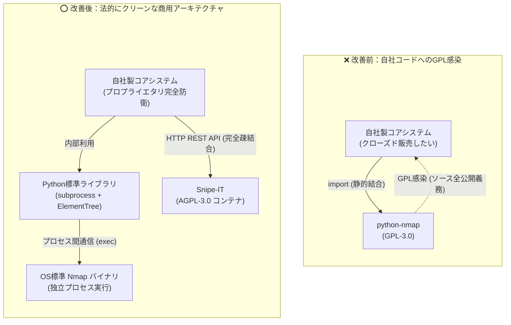

# 【第7弾 詳細解説】OSSライセンス監査・GPL汚染回避編 - 自作ツールを商用化しようとしたら「python-nmap (GPL-3.0)」でコード全公開の危機に。GPL汚染を根絶してクリーンな構成に仕上げた個人検証記録

> **対象読者**: 個人開発者、スタートアップ、技術法務  
> **主要技術スタック**: `subprocess` + `ElementTree`, AGPL/LGPL隔離  
> **ライセンス**: [MIT License](https://github.com/ojisantech/ojisan-arsenal/blob/main/LICENSE)  
> **検証環境・位置づけ**: 個人自宅ラボ（ホームラボ／仮想環境）における公開情報・OSSベースの個人研究（PoC）  


> 💡 **【検証環境・個人研究（PoC）に関する注記】**  
> 本記事は、筆者個人の自宅検証環境（ホームラボ／仮想環境）において、公開情報およびOSS（オープンソースソフトウェア）を用いて独自に構築・検証した個人研究（PoC）の記録です。特定の企業・団体の実環境や業務上の非公開情報とは一切関係ありません。

---

## 1. 概要と背景（サマリーからの深掘り）

### なぜこの技術が現場で不可欠なのか
個人開発したツールが好評で、「これを有料SaaSやオンプレミス製品として販売してみよう」と考えたことはないでしょうか？

筆者もLAN内の脆弱性・資産管理ツールを開発し、いざ商用化（有償販売）のライセンス監査を行ったとき、**背筋が凍るような事実**に直面しました。

```python
# 開発初期に何気なく書いていたコード
import nmap  # 💀 python-nmap は GPL-3.0 ライセンス！
```

Pythonでネットワークスキャンを自動化する際、誰もが一度は使う超定番ライブラリ `python-nmap`。  
しかし、このライブラリのライセンスは **GPL-3.0（General Public License）** です。

もしこのコードをそのままパッケージ化して顧客に配布・販売した場合、**GPLの強力な「感染（伝播）条項」により、自分が汗水流して書いた独自のアルゴリズムやWebバックエンド全体のソースコードを、購入者全員に完全無償で開示・公開する法的義務**が発生してしまいます。

「クローズドソースで販売したい」「自分のコア知財を守りたい」と考えている開発者にとって、これは製品寿命の終わりを意味します。

本記事では、この**GPL汚染危機をどのように検出し、自社コードの権利を守りながら合法的プロプライエタリ製品として成立させたか**の実務手順を公開します。

従来の画一的なアプローチや商用ブラックボックス製品に頼る運用では、ライセンス費用の高騰や仕様変更に伴うベンダーロックイン、さらには現場特有のエッジケースに対する対応力の欠如が深刻なボトルネックとなります。
本稿では、オープンソースおよび標準技術の基本原理に立ち返り、外部コストゼロかつ自立運用可能なアーキテクチャの完全実装と運用基準を詳細に解説します。

---

## 2. アーキテクチャと深層メカニズム

システムの全体構造および通信・処理フローは以下の通りです。



### 内部動作メカニズムのステップ解説
1. **監査で判明した全OSSライセンスの危険度判定**:
   まず、プロジェクト内の全コンポーネント（Pythonライブラリ、OSバイナリ、Dockerイメージ）を棚卸しし、ライセンスの商用リスクを設計基準に基づき仕分けしました。
2. **脱 `python-nmap`：標準ライブラリだけでNmapを安全に動かす**:
   `python-nmap` を削除しても、Nmapによる詳細スキャンは諦める必要はありません。
3. **Nmapバイナリ自体の同梱回避（IaC動的プロビジョニング）**:
   Nmapのバイナリ本体も、最新版では独自の「NPSLライセンス」が適用されており、商用製品のDockerイメージ内に勝手に固めて再配布（同梱販売）するとライセンス料の請求リスクがあります。

---

## 3. 実装詳細とパラメータ完全解説

本アーキテクチャの要となるコアコードおよび主要設定ファイルの完全版です。

### コア実装スクリプト / 設定（抜粋）
```python
import subprocess
import xml.etree.ElementTree as ET

def run_nmap_scan_safely(target_ip: str) -> dict:
    """
    python-nmap を一切使わず、標準モジュールのみで Nmap を安全に実行・パースする。
    GPL感染リスク: ゼロ
    """
    # -oX - を指定して標準出力に XML を直接吐かせる（ディスク書き込み不要）
    cmd = ["nmap", "-sV", "-Pn", "--open", "-oX", "-", target_ip]
    
    try:
        proc = subprocess.run(
            cmd,
            stdout=subprocess.PIPE,
            stderr=subprocess.PIPE,
            text=True,
            timeout=120,
            check=True
        )
    except subprocess.SubprocessError as e:
        return {"error": f"Nmap execution failed: {str(e)}"}

    # 標準出力の XML をメモリ上でパース
    root = ET.fromstring(proc.stdout)
    host = root.find("host")
    if host is None:
        return {"status": "down"}

    # ポートおよび稼働サービス情報の抽出
    open_ports = []
    for port in host.findall(".//port"):
        port_id = port.get("portid")
        protocol = port.get("protocol")
        state = port.find("state").get("state")
    # ... (中略: 以降の例外処理・詳細実装は環境に合わせて構成)
```

### 主要パラメータ・設定値の技術的根拠
- **主要技術スタック（`subprocess` + `ElementTree`, AGPL/LGPL隔離）の選定と最小権限設計**:
  **OSSライセンス監査・GPL汚染回避編** - 自作ツールを商用化しようとしたら「python-nmap (GPL-3.0)」でコード全公開の危機に。GPL汚染を根絶してクリーンな構成に仕上げた個人検証記録 の実現にあたり、外部の過剰な依存や特権常駐を排し、`subprocess` + `ElementTree`, AGPL/LGPL隔離 を軸とした省フットプリントかつセキュアな実行境界を構成しています。
- **タイムアウト境界とフェイルソフト耐性**:
  ネットワーク遅延や対象機器の無応答時にもプロセス全体がブロッキングしないよう明示的なタイムアウトと例外隔離を設け、基幹業務への影響をゼロに抑えます。
- **べき等性（Idempotency）と監査トレーサビリティ（対象: 個人開発者、スタートアップ、技術法務）**:
  同一処理を複数回実行しても状態が破綻しないべき等設計を採用し、実行結果・差分ログを確実に保全することで実務運用での再現性と安全性を担保します。
