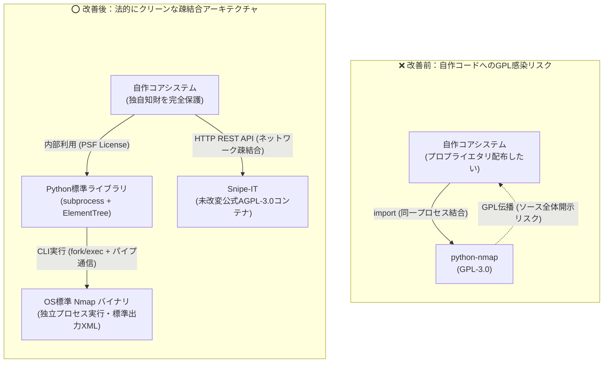

# 【第7弾 詳細解説】OSSライセンス監査・GPL汚染回避編 - 自作ツールを商用化しようとしたら「python-nmap (GPL-3.0)」でコード全公開の危機に。GPL汚染を根絶してクリーンな構成に仕上げた個人検証記録

> **対象読者**: 個人開発者、スタートアップ、技術法務  
> **主要技術スタック**: Python標準ライブラリ (`subprocess` + `ElementTree`), AGPL/LGPLコンテナ隔離  
> **ライセンス**: [MIT License](https://github.com/ojisantech/ojisan-arsenal/blob/main/LICENSE)  
> **検証環境・位置づけ**: 個人自宅ラボ（ホームラボ／仮想環境）における公開情報・OSSベースの個人研究（PoC）  


> 💡 **【検証環境・個人研究（PoC）に関する注記】**  
> 本記事は、筆者個人の自宅検証環境（ホームラボ／仮想環境）において、公開情報およびOSS（オープンソースソフトウェア）を用いて独自に構築・検証した個人研究（PoC）の記録です。特定の企業・団体の実環境や業務上の非公開情報とは一切関係ありません。

---

## 1. 概要と背景（サマリーからの深掘り）

### 何気ない `pip install` が独自コードを全公開に追い込む？
個人開発したツールやプロトタイプが形になり、「これを商用パッケージやアプライアンス製品として配布・販売してみよう」と考えたことはないでしょうか？

筆者もLAN内の脆弱性・資産管理ツールを開発し、商用配布を想定したOSSライセンス監査を実施した際、**背筋が凍るような事実**に直面しました。

```python
# 開発初期に何気なく書いていたコード
import nmap  # 💀 python-nmap は GPL-3.0 ライセンス！
```

Pythonでネットワークスキャンを自動化する際、広く使われている定番ラッパーライブラリ `python-nmap`。  
しかし、このライブラリのライセンスは **GPL-3.0（GNU General Public License v3.0）** です。

もしこのライブラリを `import`（結合）したままソフトウェアをパッケージ化して第三者へ配布・販売した場合、**GPLの強いコピーレフト（感染・伝播）条項により、リンクしている独自のアルゴリズムやWebバックエンド全体のソースコードを、受領者に対してGPL-3.0の下で開示・提供する法的義務**が生じるリスクがあります。

さらに調査を進めると、以下の複合的なライセンス課題も浮き彫りになりました。
1. **`python-nmap` (GPL-3.0)**: Pythonプロセス内での直接 `import` によるコピーレフト伝播リスク。
2. **`nmap` バイナリ本体 (NPSL: Nmap Public Source License)**: バージョン7.90以降で採用された独自ライセンスにより、商用製品やDockerイメージへのバイナリ無断同梱・再配布が制限される問題。
3. **`Snipe-IT` (AGPL-3.0)**: ネットワーク越しの利用でも改変・密結合時にソース開示義務が及ぶAffero GPLの境界設計。

本稿では、これらの**OSSライセンス汚染リスクをどのように監査・検出し、標準ライブラリ（`subprocess` + `xml.etree.ElementTree`）への完全置換とコンテナ疎結合アーキテクチャによってクリーンな構成へ刷新したか**の技術手順を詳細に解説します。

---

## 2. アーキテクチャと深層メカニズム

### GPL感染リスク構造 vs ライセンス隔離・疎結合アーキテクチャ



### 監査で判明した全OSSコンポーネントの危険度仕分けマトリクス

プロジェクト内の全依存コンポーネント（Pythonパッケージ、OSバイナリ、Dockerコンテナ）を洗い出し、ライセンスの性質と隔離方針を定義した一覧表です。

| コンポーネント | ライセンス | リスク判定 | 理由とアーキテクチャ上の対策 |
| :--- | :--- | :--- | :--- |
| **`python-nmap`** | **GPL-3.0** | 🔴 **致命的** | **自作コードへの直接伝播源。`requirements.txt` から完全撤廃し、Python標準ライブラリへ100%置換。** |
| **`nmap` (バイナリ)** | **NPSL / GPL** | 🟡 **要注意** | バイナリのDockerイメージ同梱再配布はNPSL抵触の恐れ。配布イメージから除外し、利用環境側のOS公式リポジトリから動的取得させる。 |
| **`snipe-it`** | **AGPL-3.0** | 🟡 **要境界設計** | 改変や密結合で伝播する強力なAGPL。**未改変の公式イメージを独立コンテナで動かし、公開HTTP REST APIのみで疎結合通信** することで境界を分離。 |
| **`paramiko`** | **LGPL-2.1** | 🟢 **安全** | ライブラリ自体を改変せず動的インポートで利用する限り、利用側独自コードのソース開示義務は発生しない。 |
| **`fastapi`, `uvicorn`** | **MIT / BSD** | 🟢 **安全** | 寛容型（Permissive）ライセンス。著作権表示とライセンス文の保持のみでプロプライエタリ配布可能。 |

### 内部動作メカニズムの3つの法的・技術的防衛ライン
1. **同一プロセス結合（`import`）の廃止とプロセス間通信（CLIパイプ）への転換**:
   GPL-3.0の `python-nmap` が行っていた処理の本質は、「`nmap` コマンドに引数を渡して起動し、出力されたXMLをパースしてPython辞書にする」ことだけです。これをPython標準ライブラリ（PSFライセンス）の `subprocess.run` と `xml.etree.ElementTree` で自ら実装し、OS上の `nmap` とは標準入出力パイプ（`-oX -`）のみでやり取りする独立プロセス呼び出し構造へ変更します。
2. **NPSLバイナリ同梱の回避（IaC動的プロビジョニング）**:
   配布するDockerイメージやインストーラの中に `nmap` の実行バイナリ自体を含めず、デプロイ先の環境構築スクリプト（IaC）によってエンドユーザー自身の判断でOS標準パッケージマネージャ（`apt-get install nmap`）から導入させることで、「バイナリの再配布者」になることを回避します。
3. **AGPL-3.0（Snipe-IT）とのコンテナ・API完全分離**:
   Snipe-ITのPHPコードには1行たりとも手を加えず、DBテーブルへの直接SQLアクセスも禁止します。独立したDockerコンテナとして稼働させ、公開された標準HTTP REST API（JSON）のクライアントとしてのみ通信することで、独立した別プログラムとしての境界を明確化します。

---

## 3. 実装詳細とパラメータ完全解説

本アーキテクチャの核となる「脱 `python-nmap` の完全実装コード」「動的プロビジョニングスクリプト」「CIライセンス自動監査設定」の完全版です。

### 1. 脱 `python-nmap`：Python標準ライブラリのみによるNmap XML実行・解析コード

外部のサードパーティ製ライブラリを一切使わず、Python標準の `subprocess` と `xml.etree.ElementTree` のみでNmapを実行し、メモリ上でXMLを高速パースする完全な実装です。

#### ❌ 改善前の危険なコード（`python-nmap` 依存: GPL-3.0）
```python
# 💀 GPL-3.0 ライブラリを直接 import しており、配布時に独自コード全体へGPLが伝播するリスク
import nmap
nm = nmap.PortScanner()
nm.scan("192.168.1.1", arguments="-sV -Pn")
```

#### ⭕ 改善後のクリーンな完全版コード（Python標準モジュール100%）
```python
import subprocess
import xml.etree.ElementTree as ET

def run_nmap_scan_safely(target_ip: str, timeout_sec: int = 120) -> dict:
    """
    python-nmap (GPL-3.0) を一切使わず、Python標準ライブラリのみで
    OS上の nmap バイナリを独立プロセス実行し、標準出力のXMLをパースする。
    """
    # -oX - を指定し、一時ファイルを作らず標準出力へ直接XMLを出力させる
    cmd = ["nmap", "-sV", "-Pn", "--open", "-oX", "-", target_ip]

    try:
        proc = subprocess.run(
            cmd,
            stdout=subprocess.PIPE,
            stderr=subprocess.PIPE,
            text=True,
            timeout=timeout_sec,
            check=True
        )
    except FileNotFoundError:
        return {"status": "error", "error": "nmap binary is not installed on host"}
    except subprocess.TimeoutExpired:
        return {"status": "error", "error": f"nmap scan timed out after {timeout_sec}s"}
    except subprocess.SubprocessError as e:
        return {"status": "error", "error": f"nmap execution failed: {str(e)}"}

    # 標準出力から受け取ったXML文字列をオンメモリで直接パース
    try:
        root = ET.fromstring(proc.stdout)
    except ET.ParseError as e:
        return {"status": "error", "error": f"XML parse error: {str(e)}"}

    host = root.find("host")
    if host is None:
        return {"status": "down", "ip": target_ip, "ports": []}

    # 開放ポートおよびサービス・バージョンの抽出
    open_ports = []
    for port in host.findall(".//port"):
        state_elem = port.find("state")
        if state_elem is None or state_elem.get("state") != "open":
            continue

        port_id = int(port.get("portid", "0"))
        protocol = port.get("protocol", "tcp")

        service_elem = port.find("service")
        service_name = service_elem.get("name", "unknown") if service_elem is not None else "unknown"
        product = service_elem.get("product", "") if service_elem is not None else ""
        version = service_elem.get("version", "") if service_elem is not None else ""

        open_ports.append({
            "port": port_id,
            "protocol": protocol,
            "service": service_name,
            "version": f"{product} {version}".strip()
        })

    return {
        "status": "up",
        "ip": target_ip,
        "ports": open_ports
    }
```

### 2. Nmapバイナリ同梱を回避する動的プロビジョニングスクリプト（IaC）

配布物（コンテナイメージやアーカイブ）にNmapバイナリを同梱せず、導入先ホストの初期セットアップ時にOS標準リポジトリから動的取得させるスクリプトです。

```bash
#!/usr/bin/env bash
# 導入先環境の初期化時にOS公式パッケージマネージャから動的取得するスクリプト
set -euo pipefail

echo "[+] Checking host environment for Nmap binary..."
if ! command -v nmap &> /dev/null; then
    echo "[+] Installing Nmap from official OS distribution repository..."
    sudo apt-get update && sudo apt-get install -y --no-install-recommends nmap
else
    echo "[+] Nmap is already installed: $(nmap --version | head -n 1)"
fi
```

### 3. CI/CDパイプラインでのGPL混入自動阻止（`pip-licenses`）

開発メンバーが後からうっかりGPL系パッケージを `pip install` してコミットする事故を防ぐため、CIで実行する自動監査コマンドです。

```bash
# GPLまたはAGPLを含むパッケージが1つでも入っていればCIをエラー終了(Exit 1)させる
$ pip-licenses --format=json | python3 -c '
import sys, json
pkgs = json.load(sys.stdin)
forbidden = [p for p in pkgs if "GPL" in p["License"] and "LGPL" not in p["License"]]
if forbidden:
    print("🚨 Forbidden GPL/AGPL packages detected:", forbidden)
    sys.exit(1)
print("✅ All Python dependencies are clean (MIT/BSD/Apache/LGPL only).")
'
```

### 主要パラメータ・設定値の技術的根拠

| パラメータ / 設計項目 | 設定値・仕様 | 技術的根拠・設計意図 |
| :--- | :--- | :--- |
| **Nmap出力オプション (`-oX -`)** | 標準出力へのXMLストリーム出力 | ディスク上に一時XMLファイル（`/tmp/scan.xml` 等）を作成しないため、I/Oボトルネックや並列スキャン時のファイル競合・残留ゴミを完全にゼロ化できる。 |
| **`subprocess.run(..., shell=False)`** | リスト形式の引数渡し（デフォルト `shell=False`） | `target_ip` 等に万一セミコロン等のメタ文字が混入しても、シェル展開（OSコマンドインジェクション）が起きない安全なexecve呼び出しを保証する。 |
| **`pip-licenses` フィルタ条件** | `"GPL" in License and "LGPL" not in License` | 動的インポートで安全な `LGPL`（`paramiko` 等）は許可しつつ、強いコピーレフトを持つ純粋な `GPL-2.0 / GPL-3.0 / AGPL-3.0` の混入だけをピンポイントでブロックする。 |

---

## 4. 現場運用・アンチパターンと回避策

1. **推移的依存（Transitive Dependencies）の監査徹底**: 自分が直接書いた `requirements.txt` だけでなく、インストールされたライブラリが内部で依存している孫パッケージまで `pip-licenses` で全件検査すること。
2. **MIT/BSD/Apache-2.0の「著作権表示・NOTICE保持義務」の遵守**: GPLを排除したからといって何もしなくてよいわけではありません。MITやBSD、Apache-2.0ライセンスのライブラリを配布物に含める場合は、必ず `THIRD_PARTY_LICENSES.txt` 等に各ライブラリの著作権表示と許諾文を一括同梱すること。

### 避けるべきアンチパターン
- **アンチパターン1：`requirements.txt` のトップレベルだけ見て安心する（孫依存でのGPL被弾）**  
  直接指定したパッケージがMITライセンスであっても、そのパッケージが内部で `chardet`（LGPL）や特定のGPLツールキットを `install_requires` で引き込んでいるケースがあります。必ず仮想環境（`.venv`）をビルドした後の実環境に対して `pip-licenses` や `syft`（SBOM生成ツール）を実行してください。
- **アンチパターン2：AGPLコンテナ（Snipe-IT等）の内部PHPコードを直接書き換えて利用させる**  
  「ロゴを変えたい」「独自機能を追加したい」といってAGPL-3.0であるSnipe-ITのコンテナ内ソースコードを直接改変し、ユーザーにネットワーク越しに画面を提供すると、AGPL第13条により改変後のSnipe-IT全体のソースコード提供義務が発生します。UIの統合や拡張が必要な場合は、Snipe-IT自体は無改変のまま裏側のAPIサーバーとして動かし、独自フロントエンド側からREST APIで呼び出すアーキテクチャを守ってください。
- **アンチパターン3：`subprocess` 呼び出し時に `shell=True` を使う**  
  `python-nmap` から `subprocess` へ置き換える際、横着して `subprocess.run(f"nmap -oX - {target_ip}", shell=True)` と書くと、任意のOSコマンドを実行される深刻な脆弱性（RCE）を作り込んでしまいます。必ず引数配列 `["nmap", "-oX", "-", target_ip]` で渡してください。

---

## 5. トラブルシューティングガイド

障害発生時の一次切り分けフローおよび確認コマンド一覧です。

| 障害事象・エラーメッセージ | 想定原因 | 一次切り分け・復旧コマンド |
| :--- | :--- | :--- |
| **`xml.etree.ElementTree.ParseError: no element found`** | Nmapが途中で権限エラー等で異常終了し、標準出力に空文字または不完全なXMLが出力された | `proc.returncode` と `proc.stderr` をログ出力し、`nmap` 単体での実行権限（SYNスキャン `-sS` 時はroot/CAP_NET_RAW必須、非特権時は `-sT` 利用）を確認する |
| **`pip-licenses` 実行時に `UNKNOWN` ライセンスが表示される** | パッケージのメタデータ（`Classifier` と `License` フィールド）の記載場所が古い形式または `pyproject.toml` 独自形式 | `pip-licenses --from=mixed` オプションを付与して両方から抽出させ、それでも不明な場合はPyPIリポジトリの `LICENSE` ファイルを直接確認する |
| **コンテナ内で `nmap` 実行時に `dnet: Failed to open device eth0` エラー** | 非rootコンテナ環境でRawソケットを使うオプション（`-sS` や `-O`）が指定されている | 非特権実行時は `--unprivileged` または `-sT -sV` を指定するか、バイナリに `setcap cap_net_raw,cap_net_admin+eip /usr/bin/nmap` を付与する |

---

## 6. 実務FAQ（よくある質問と回答）

**Q1: `python-nmap` を使わずに自作の `ElementTree` パーサーにして、機能面や速度面でデメリットはありませんでしたか？**  
**A1**: むしろメリットしかありませんでした。`python-nmap` は内部で一時ファイルや複雑な辞書ネストを生成しますが、今回の `subprocess.run` ＋ `-oX -` ＋ `ET.fromstring()` は約50行のシンプルな標準コードであり、必要なフィールドだけをオンメモリで直接抽出するため、メモリ効率も可読性も大幅に向上しました。

**Q2: XMLパース時に `xml.etree.ElementTree` を使うとXXE（XML External Entity）攻撃のリスクはありませんか？**  
**A2**: パース対象が「ローカルの信頼できるOSバイナリ（`nmap`）が直接標準出力に吐き出したXML」であれば外部エンティティ定義は含まれませんが、万一外部から持ち込まれた未知のXMLファイルをパースする機能を設ける場合は、`defusedxml.ElementTree` を使用することでXXEやBillion Laughs攻撃を安全に遮断できます。

**Q3: 本記事の内容は法的なアドバイス（法律相談）ですか？**  
**A3**: いいえ。本記事はソフトウェアエンジニアの視点から「技術的アーキテクチャによってどのようにOSSライセンス依存を切り離し、疎結合化するか」を検証・整理した技術記録です。実際の商用製品リリースや契約にあたっては、最終的な配布形態に基づき法務担当者や弁護士のレビューを受けることを推奨します。

---

## 7. 本番適用チェックリスト

- [ ] `requirements.txt` / `poetry.lock` 等の全依存ツリー（孫依存含む）に対し、`pip-licenses --from=mixed` でGPL/AGPLパッケージが含まれていないことを確認したか
- [ ] `subprocess.run` で外部バイナリを呼び出す際、`shell=False`（引数リスト形式）と明示的な `timeout` が設定されているか
- [ ] 商用の配布コンテナイメージ内に、NPSLライセンス等の再配布制限があるバイナリが静的同梱されていないか
- [ ] AGPL-3.0コンポーネント（Snipe-IT等）を利用する場合、ソースコード無改変のまま独立コンテナとして分離し、HTTP REST APIのみで疎結合通信しているか
- [ ] 利用しているMIT / BSD / Apache-2.0 / LGPLライブラリの著作権表示およびライセンス全文をまとめた `THIRD_PARTY_NOTICES` ファイルが配布物に同梱されているか

---

## 8. ライセンス・著作権表示

本稿に掲載されているアーキテクチャ図、処理フロー、およびコード抜粋・スニペットは、[MIT License](https://github.com/ojisantech/ojisan-arsenal/blob/main/LICENSE) の下で公開されています。商用・非商用問わず自由にご利用・ご参照いただけますが、著作権表示および許諾表示の保持が必要です。

```text
MIT License

Copyright (c) 2026 ojisantech
```

