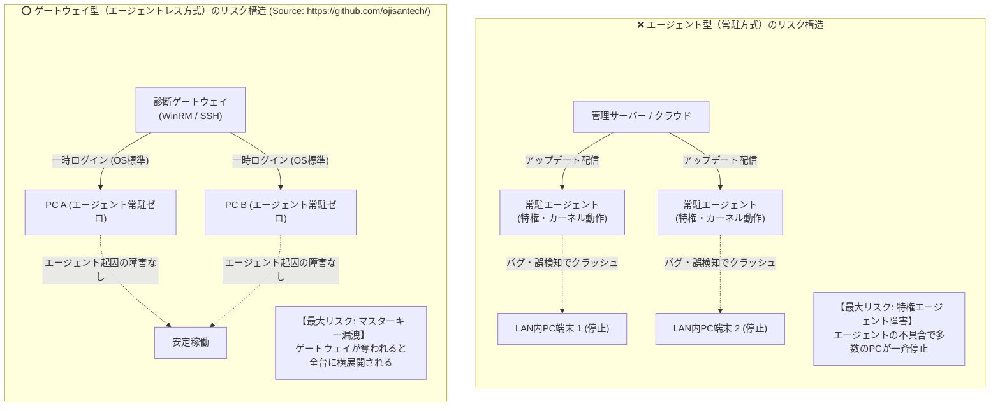
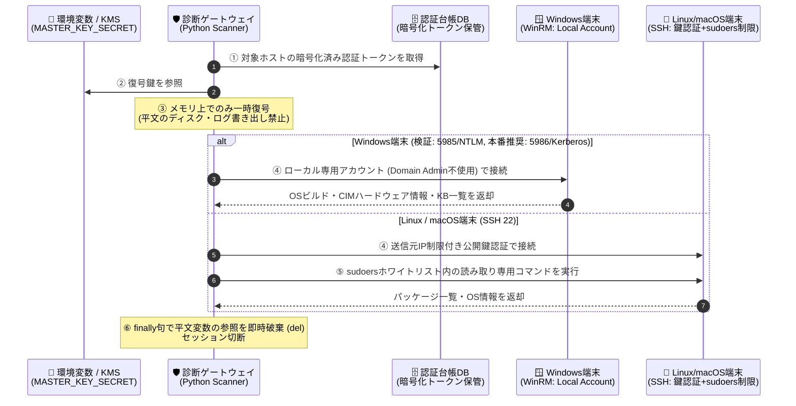

# 【第8弾 詳細解説】エージェントレス思想 ＆ マスターキー防衛編 - 「全LAN内PC端末に常駐エージェントを入れる」は本当に安全か？ CrowdStrike障害以降に再考するエージェントレス型資産管理のメリデメとマスターキー防衛

> **対象読者**: セキュリティアーキテクト、CIO、情シス責任者  
> **主要技術スタック**: WinRM, SSH公開鍵認証, sudoers最小権限, 認証付き暗号（Fernet / AES-256-GCM）  
> **ライセンス**: [MIT License](https://github.com/ojisantech/ojisan-arsenal/blob/main/LICENSE)  
> **検証環境・位置づけ**: 個人自宅ラボ（ホームラボ／仮想環境）における公開情報・OSSベースの個人研究（PoC）  


> 💡 **【検証環境・個人研究（PoC）に関する注記】**  
> 本記事は、筆者個人の自宅検証環境（ホームラボ／仮想環境）において、公開情報およびOSS（オープンソースソフトウェア）を用いて独自に構築・検証した個人研究（PoC）の記録です。特定の企業・団体の実環境や業務上の非公開情報とは一切関係ありません。

---

## 1. 概要と背景（サマリーからの深掘り）

### なぜこの技術が現場で不可欠なのか：当たり前だった「エージェント常駐」の常識が揺らいだ日
情シスやセキュリティ担当者にとって、長年「端末管理・脆弱性診断といえばエージェントソフトを全台にインストールするのが当たり前」でした。

* 「常駐ソフトがCPUやメモリの情報を収集して中央にプッシュ送信する」
* 「カーネルレベルで挙動を常時監視してセキュリティを守る」

しかし、2024年に世界中で発生した **CrowdStrikeの大規模ブルースクリーン（BSOD）障害** は、すべてのインフラエンジニアに大きな衝撃を与えました。  
「安全を守るための特権エージェントが、定義ファイルやアップデートの不具合によって大規模なシステム停止を引き起こし得る」という現実が浮き彫りになったからです。

さらに、常駐エージェント方式には以下の構造的リスクが常に付きまといます。

1. **カーネル空間・SYSTEM権限での常駐リスク**:  
   多くの管理エージェントはOSの深部（Ring 0 / SYSTEM権限）で常時稼働します。ドライバやエージェント更新の不具合が、そのままOSの起動不能（BSOD / カーネルパニック）に直結するリスクがあります。
2. **エージェント自身の脆弱性によるサプライチェーン攻撃**:  
   管理ソフト自体にRCE（リモートコード実行）や権限昇格の脆弱性が見つかった場合、守るためのツールが「全端末へマルウェアを配布する経路」として悪用される危険があります。
3. **「エージェントを管理するための運用コスト」の肥大化**:  
   OSメジャーアップデート時の互換性検証、エージェントがサイレント停止した端末の洗い出し、リソース競合（CPU高負荷）の調査など、本来の業務以外の保守工数が膨張します。

そこで改めて注目されているのが、**「端末側にはサードパーティ製エージェントを入れず、OS標準機能（WinRM / SSH）を使って外部から必要な時だけ診断するエージェントレス型（ゲートウェイ型）」** です。

本記事では、両者のメリット・デメリットを現場目線で比較した上で、エージェントレス型を採用する際に避けて通れない **「マスターキー漏洩リスク（単一障害点）」をどう抑止・局所化するか** の設計論と実装例を解説します。

---

### 現場目線での徹底比較マトリクス（エージェント型 vs ゲートウェイ型）

カタログスペックではなく、運用現場で実際に起こるトラブルや運用負荷をベースに比較したマトリクスが以下です。

| 比較項目 | エージェント型（常駐型） | ゲートウェイ型（エージェントレス） |
| :--- | :--- | :--- |
| **端末への影響・負荷** | **△ 高リスク**: 常駐ソフトのバグや競合で高負荷になったり、カーネルドライバ不具合でOSがクラッシュする危険がある | **◎ 低リスク**: サードパーティ製の常駐プロセスはゼロ。診断時のみOS標準機能が動くため、エージェント起因の障害リスクを大幅に低減できる |
| **導入・更新の手間** | **△ 煩雑**: 何百台ものPCにインストーラー配布が必要。バージョンアップやアンインストール失敗時の個別対応も負担が大きい | **◎ 容易**: 端末側への独自ソフト配布は不要。OS標準のWinRM/SSHを有効化するだけで開始可能 |
| **対象機器の範囲** | **△ 制限大**: エージェントを入れられないアプライアンス、ルーター、NAS、古いレガシーOSは管理対象外になる | **◎ 幅広い**: 標準プロトコルで接続できれば、Linux、Windows、macOS、ルーター、NASまで幅広く管理可能 |
| **ネットワーク要件** | **◎ 容易**: 端末から管理サーバーへの外向き通信（HTTPS 443番等）が出られればNAT配下でも動作 | **△ 要設計**: 診断ゲートウェイから端末へのインバウンド通信（SSH 22番 / WinRM 5985・5986番）を許可する設計が必要 |
| **最大の弱点・リスク** | **🚨 サプライチェーン攻撃 / 特権エージェント障害**<br/>エージェントの脆弱性悪用や更新不具合で多数のPCが一斉に停止するリスク | **🚨 マスターキーの漏洩（単一障害点）**<br/>ゲートウェイが対象PCの認証情報（パスワード・秘密鍵）を扱うため、侵害されると横展開されるリスク |

---

## 2. アーキテクチャと深層メカニズム

### システム俯瞰図：リスク構造の対比
エージェント型における「特権エージェント障害リスク」と、ゲートウェイ型（エージェントレス）における「マスターキー集中リスク」の構造的対比は以下の通りです。



### マスターキー防衛・オンメモリ復号診断シーケンス
診断ゲートウェイが単一障害点（SPOF）とならないよう、認証情報の暗号化保管・オンメモリ復号・最小権限コマンド実行を組み合わせた防衛フローは以下の通りです。



---

### エージェントレス最大の弱点「マスターキー漏洩」を防ぐ3原則（深層解説）

エージェントレス型には「端末側にサードパーティ製エージェントを常駐させないため、エージェント起因の障害リスクを大幅に低減でき、導入も容易」という大きな利点がある一方で、セキュリティ担当者が最も警戒するのが**「診断サーバーが侵入されたら、全PCの管理者パスワードが盗まれて全端末に侵入されるのではないか？」**という懸念です。

この課題をアーキテクチャレベルで抑止・局所化するため、本システムでは以下の **「マスターキー防衛の3原則」** を設計の基本としています。

#### 原則①：ドメイン管理者（Domain Admin）権限を使わない
Active Directoryの最強権限である `Domain Admins` のアカウントをスキャナーに登録してはいけません。万が一スキャナーのメモリや設定が奪われた場合、ドメインコントローラーを含む全サーバーへ即座に横展開（Pass-the-Hash / Lateral Movement）されるためです。
* **対策**: 必ず**「ローカルの診断専用アカウント（例: `AssetAdmin` / `AssetScanUser`）」**を対象端末上に作成し、ドメイン権限から切り離します。
* **さらなる堅牢化（LAPS連携）**: 端末ごとに異なるランダムパスワードを割り当てるか、Microsoft標準の **Windows LAPS（Local Administrator Password Solution）** と連携させることで、仮に1台分の認証情報が漏洩しても他端末への横展開を防止できます。

#### 原則②：Linux/macOS端末は「公開鍵認証のみ ＋ sudoersコマンド限定 ＋ 送信元IP固定」
SSH接続を行うLinux/macOS端末に対しては、パスワード総当たりや使い回しリスクを排除するため、パスワード認証を禁止して**公開鍵認証（Ed25519 / RSA）のみ**を許可します。
* **コマンドホワイトリスト制限**: 診断専用ユーザー（`assetscan`）が特権（`sudo`）で実行できるコマンドを `/etc/sudoers.d/asset_scanner` で**読み取り専用の情報収集コマンドのみ**に厳密に絞り込みます。
  * ※Linux（Debian/RHEL系）では `dpkg -l`, `rpm -qa`, `apt list --upgradable` 等を指定し、**macOS**ではパッケージ管理体系が異なるため `system_profiler SPSoftwareDataType`, `softwareupdate -l`, `pkgutil --pkgs`, `/opt/homebrew/bin/brew list` 等へ置き換えます。
* **送信元IP制限 (`from="..."`)**: `~/.ssh/authorized_keys` にて診断ゲートウェイのIPアドレス以外からの鍵利用を拒否します。これにより、仮に診断サーバーから秘密鍵が流出した場合でも別端末からの不正ログインを拒否でき、万一SSH接続されたとしても実行可能な操作は `assetscan` ユーザー権限に限定されるため、`root`権限を用いたシステム設定改ざん・データ消去（`rm -rf` 等）といった特権破壊操作を制限できます。

#### 原則③：認証付き暗号による保管とオンメモリ復号（実装例：Fernet ／ 本番推奨：AES-256-GCM）
サーバーのデータベースや設定ファイル（`.env`, `config.yaml` 等）に各端末のパスワードを平文で保存するのは厳禁です。
* **暗号化方式の選定（パターンB：本番推奨とPoC実装例）**:
  * **本番推奨**: **`AESGCM`（AES-256-GCM）** などの256ビット鍵長の認証付き暗号（AEAD）と、クラウドKMS / HSM（Hardware Security Module）による鍵管理の組み合わせ。
  * **PoC実装例**: Python `cryptography.fernet.Fernet`（内部仕様は **AES-128-CBC + HMAC-SHA256** による認証付き暗号スキーム）を用い、暗号文の機密性と改ざん検知を簡潔に実装。
* **平文寿命の最小化とPythonランタイム上の注意点**:  
  スキャン実行時のみメモリ上で復号してセッションを張り、`try ... finally` ブロックで `del plain_password` を実行して**変数参照を即座に破棄し、アプリケーションスコープ上での平文寿命を最小化**します（ディスクやログファイルへの平文書き出しも禁止します）。  
  > ⚠️ **【技術的補足：Pythonにおけるメモリ消去の限界】**  
  > Python（CPython）の `str` 型はイミュータブル（不変）オブジェクトであるため、`del plain_password` は**「変数参照の削除（ガベージコレクション対象化）」**であり、物理メモリ上のバイト列をゼロ埋め（Zero-fill）するものではありません。GC回収までの間や、CPython内部バッファ・通信ライブラリ側のバッファに平文断片が残存する可能性があります。より高い機密性が求められる環境では、`bytearray` と `ctypes.memset` を用いた明示的なゼロ化や、外部HSM/KMS・短命証明書（エフェメラル認証）との連携を推奨します。

---

## 3. 実装詳細とパラメータ完全解説

本アーキテクチャの要となる「オンメモリ復号＆セッション管理」「Linux/macOS側 sudoers / SSH公開鍵制限」の実装コードと設定定義です。

### ① 診断ゲートウェイ側：オンメモリ復号 ＆ WinRM接続ロジック（Python実装例）

> ※以下のサンプルコードでは、**自宅ラボ・ワークグループ検証環境向け**として `Fernet`（AES-128-CBC + HMAC-SHA256）および WinRM HTTP（`5985`）＋ `NTLM` 認証を使用しています。**企業の本番環境（Active Directory環境等）では、暗号化に `AESGCM`（AES-256-GCM）、通信経路に WinRM HTTPS（`5986` / TLS証明書検証）および `Kerberos` 認証（または証明書認証）を採用することを強く推奨します。**

```python
# 診断実行時のみメモリ上で復号して接続するセキュアコネクタ (PoC実装例)
# 暗号化実装例: Fernet (AES-128-CBC + HMAC-SHA256) ※本番環境では AESGCM (AES-256-GCM) + KMS を推奨
from cryptography.fernet import Fernet, InvalidToken
import winrm
import os
import logging

# 環境変数（またはKMS/Docker Secret）から復号鍵をロード
ENCRYPTION_KEY = os.environ.get("MASTER_KEY_SECRET")
if not ENCRYPTION_KEY:
    raise RuntimeError("MASTER_KEY_SECRET is not configured in environment.")

cipher = Fernet(ENCRYPTION_KEY.encode("utf-8") if isinstance(ENCRYPTION_KEY, str) else ENCRYPTION_KEY)

def connect_target(encrypted_password: bytes, target_ip: str, scan_user: str = "AssetAdmin") -> dict:
    """
    暗号化された認証トークンをメモリ上で復号し、WinRMで最小限の資産情報を取得する。
    利用完了後にfinallyブロックで平文パスワードの参照を破棄し、平文寿命を最小化する。
    """
    plain_password = None
    try:
        # 1. メモリ上で平文復号（ディスク書き出し・ログ出力禁止）
        plain_password = cipher.decrypt(encrypted_password).decode("utf-8")

        # 2. タイムアウト境界を明示したWinRMセッション確立
        # ※検証環境例: HTTP(5985) + NTLM / 本番推奨: HTTPS(5986) + Kerberos または証明書認証
        session = winrm.Session(
            f"http://{target_ip}:5985/wsman",
            auth=(scan_user, plain_password),
            transport="ntlm",
            read_timeout_sec=15,
            operation_timeout_sec=10
        )

        # 3. 読み取り専用のCIMクエリでOS名・ビルド番号・ホスト名を取得
        ps_query = (
            "$os = Get-CimInstance Win32_OperatingSystem; "
            "[PSCustomObject]@{Hostname=$os.CSName; Caption=$os.Caption; Build=$os.BuildNumber} | ConvertTo-Json -Compress"
        )
        res = session.run_ps(ps_query)
        return {
            "ip": target_ip,
            "status": "success" if res.status_code == 0 else "error",
            "output": res.std_out.decode("utf-8", errors="ignore").strip()
        }
    except InvalidToken:
        logging.error(f"[{target_ip}] 認証トークンの復号に失敗しました（鍵不一致または改ざん検知）")
        return {"ip": target_ip, "status": "decrypt_failed"}
    except Exception as e:
        # 例外ログに平文パスワードが含まれないようエラー型のみ記録
        logging.warning(f"[{target_ip}] WinRM接続失敗: {type(e).__name__}")
        return {"ip": target_ip, "status": "unreachable"}
    finally:
        # 4. 利用完了後に変数参照を破棄し、スコープ内の平文寿命を最小化
        # (注: Pythonのdelは参照削除であり物理メモリのゼロ埋めではない点に留意)
        if plain_password is not None:
            del plain_password
```

### ② Linux/macOS端末側：`sudoers` コマンド限定 ＆ `authorized_keys` 送信元制限

診断専用アカウント `assetscan` に対し、パッケージ一覧やサービス状態の**読み取りコマンドのみ**をフルパス指定で許可します。さらに `NOEXEC` タグを併用することで、多くのシェルエスケープ（サブシェル起動）を抑止します。

```sudoers
# /etc/sudoers.d/asset_scanner (パーミッション: 0440)
# 1. バッチ実行のためTTY要求を無効化し、動的リンクバイナリからのサブシェル起動(NOEXEC)を抑止
Defaults:assetscan !requiretty, noexec

# 2. 診断専用ユーザーには、情報取得用の読み取り専用コマンド（フルパス＋引数固定）のみを許可する
# ※以下はLinux (Debian/RHEL系) の例。macOSの場合は softwareupdate -l や system_profiler 等を指定
Cmnd_Alias ASSET_READ_CMDS = \
    /usr/bin/dpkg -l, \
    /usr/bin/rpm -qa, \
    /usr/bin/systemctl list-units --type=service --no-pager, \
    /usr/bin/apt list --upgradable

assetscan ALL=(root) NOPASSWD: NOEXEC: ASSET_READ_CMDS
```

さらに、対象端末の `/home/assetscan/.ssh/authorized_keys` には以下の制約を付与し、診断ゲートウェイ（例: `192.168.1.200`）以外からの接続およびポートフォワーディング悪用を制限します。

```text
from="192.168.1.200",no-port-forwarding,no-X11-forwarding,no-agent-forwarding,no-pty ssh-ed25519 AAAAC3NzaC1lZDI1NTE5AAAAI... asset-scanner-gateway
```

---

### 主要パラメータ・設定値の技術的根拠

| パラメータ / 設定項目 | 設定値・推奨構成 | 技術的根拠（なぜこの設計なのか） |
| :--- | :--- | :--- |
| **認証情報暗号化方式** | **本番推奨**: `AESGCM` (AES-256-GCM)<br/>**実装例**: `Fernet` (AES-128-CBC + HMAC-SHA256) | 単なる暗号化だけでなく、認証タグ（GCM / HMAC）により「DB内の暗号文が改ざんされていないか」を復号時に検証（認証付き暗号: AEAD相当）するため。 |
| **WinRM 通信・認証方式** | **検証環境例**: HTTP (`5985`) + `NTLM`<br/>**本番推奨**: HTTPS (`5986`/TLS) + `Kerberos` / 証明書認証 | ワークグループ検証環境では構成が容易な `5985` + `NTLM` を例示していますが、実運用環境では中間者攻撃やNTLMリレーを防ぐため `5986`（TLS）および `Kerberos` 認証を推奨します。 |
| **`sudoers` の `NOEXEC` ＆ フルパス指定** | `NOPASSWD: NOEXEC: /usr/bin/dpkg -l` | フルパス固定により `PATH` 書き換えによる偽バイナリ実行を防ぎ、`NOEXEC` により動的リンクバイナリからの多くのシェルエスケープを抑止します（※静的リンクバイナリ等では回避され得るため、シェル機能を持たないコマンドのみを許可することが前提です）。 |
| **SSH `authorized_keys` オプション** | `from="GW_IP",no-pty,no-port-forwarding` | 秘密鍵が万が一漏洩しても、許可されたゲートウェイIP以外からの接続をSSHデーモン側で拒否し、踏み台化（SSHトンネル悪用）も無効化します。 |
| **WinRM タイムアウト (`operation_timeout_sec=10`)** | Read: `15s` / Operation: `10s` | スリープ中や電源オフのPCに対してスキャナーが長時間ブロックされるのを防ぎ、多数端末のスキャンを短時間で完了させるため。 |

---

## 4. 現場運用・アンチパターンと回避策

### 適材適所で「ハイブリッド」に守る設計指針
エージェント型とエージェントレス型、どちらか一方がすべての環境で唯一の正解というわけではありません。環境の特性に応じて以下のように使い分けるのが、現代のインフラ設計の合理的なアプローチです。

* **クラウド上のオートスケールするコンテナや動的なVM群** ➔ 端末側から外向き通信で自律報告する **「エージェント型」** が有利
* **LAN内PC端末、ファイルサーバー、NAS、ネットワーク機器、検証機** ➔ サードパーティ製常駐ソフトによる障害リスクを大幅に低減でき、ブラックボックス常駐を排除できる **「エージェントレス型（ゲートウェイ型）」** が適している

### 避けるべき現場アンチパターン

- **アンチパターン1：スキャナーに「Domain Admins」や全LAN内共通の管理者アカウントを登録する**  
  「設定が楽だから」とActive Directoryのドメイン管理者アカウントをスキャナーに設定するのは危険なアンチパターンです。診断ゲートウェイが侵害された瞬間、全サーバー・全PCへ横展開されるリスクがあります。必ずローカル専用アカウント（またはLAPS）に分離し、ファイアウォールで診断ゲートウェイのIPからのみ5985/5986/22番ポートを受け付けるよう制限してください。
- **アンチパターン2：`sudoers` に `ALL=(ALL) NOPASSWD: ALL` を設定してしまう**  
  エージェントレス診断用のLinux/macOSアカウントに無制限の `NOPASSWD: ALL` を与えると、SSH鍵が漏れた際に特権を用いたランサムウェア展開や `/etc/shadow` の読み取りが可能になります。必ず `Cmnd_Alias` で引数まで含めた読み取りコマンドのみをホワイトリスト定義してください。
- **アンチパターン3：例外トレースバックやデバッグログへの平文パスワード露出**  
  メモリ上で復号していても、接続エラー発生時に `logging.exception(f"Failed with auth={plain_password}")` のようにログ出力してしまえば、ログファイル上に平文パスワードが永続化されてしまいます。エラーログにはホストIPと例外クラス名（`type(e).__name__`）のみを出力し、認証情報は文字列フォーマットに含めないでください。

---

## 5. トラブルシューティングガイド

エージェントレス診断およびマスターキー防衛構成において、導入・運用時に発生しやすい事象と一次切り分けコマンドの一覧です。

| 障害事象・エラーメッセージ | 想定原因 | 一次切り分け・復旧コマンド |
| :--- | :--- | :--- |
| **`cryptography.fernet.InvalidToken`** | 環境変数 `MASTER_KEY_SECRET` の不一致、または暗号化トークン生成時の鍵との不整合 | ゲートウェイ上で `echo $MASTER_KEY_SECRET \| wc -c` を確認し、暗号化トークン生成時の鍵と一致しているか検証 |
| **`sudo: a terminal is required to read the password`** | Linux/macOS側の `/etc/sudoers.d/asset_scanner` の構文エラー、または実行コマンドの引数が許可リストと不一致 | 対象端末で `sudo visudo -cf /etc/sudoers.d/asset_scanner` を実行し構文とパーミッション（`0440`）を確認 |
| **`SSH: Permission denied (publickey)`** | `authorized_keys` の `from="IP"` 指定とゲートウェイの実送信元IP（NAT/Docker Bridge）の不一致 | 対象端末の認証ログ（`/var/log/auth.log` 等）を確認し、Dockerコンテナから接続している場合はホストネットワークまたは正しいGW IPを `from=` に指定 |
| **`WinRM: 401 Unauthorized` (ワークグループ端末)** | WindowsのUACリモート制限によりローカル管理者のトークンが格下げされている | 対象Windowsで `LocalAccountTokenFilterPolicy = 1` が設定されているか、および `winrm get winrm/config/service` を確認 |

---

## 6. 実務FAQ（よくある質問と回答）

**Q1: エージェントレス型だと、不審なプロセスのリアルタイム検知（EDR機能）はできないのではないですか？**  
**A1**: はい、ミリ秒単位のプロセス挙動監視や通信遮断はEDR（Windows Defender for Endpoint等）の領域です。重要なのは「IT資産管理・パッケージ棚卸し・脆弱性スキャン・パッチ適用まで、用途ごとにサードパーティ製の特権常駐エージェントを何個も重ね入れしないこと」です。OS標準のセキュリティ機能を活かしつつ、資産管理や脆弱性診断はエージェントレスで行うことで、常駐ソフト同士の競合やシステム障害リスクを大幅に低減できます。

**Q2: 診断ゲートウェイのサーバー自体にroot侵入されたら、環境変数のマスターキーも奪われませんか？**  
**A2**: その通りです。したがって「たとえゲートウェイ上の秘密鍵や復号鍵が奪われ、対象端末へSSHログインされたとしても、特権による被害を最小限に抑え込む」ための多層防御が **原則①（Domain Admin禁止・LAPS連携）** と **原則②（SSH `from=` IP制限 ＋ `sudoers` 読み取り専用コマンド限定）** です。仮に攻撃者が診断ゲートウェイを乗っ取って対象Linux端末へSSH接続できたとしても、実行可能な操作は `assetscan` ユーザー権限に限定されるため、**`root`権限（`sudo`）を用いたシステム設定の改ざん・サービス停止・パッケージ削除といった特権破壊操作は `sudoers` ホワイトリストによって制限されます**（※さらに `~/.ssh/authorized_keys` の `command="..."` オプションで単一の診断スクリプト実行のみに固定すれば、ログイン後の任意コマンド実行自体も抑止可能です）。

**Q3: ファイアウォールで全PCの22番・5985（5986）番ポートを開けるのが不安です。どう設計すべきですか？**  
**A3**: 全ネットワークに対してポートを開放するのではなく、Windows Defenderファイアウォールや `ufw` / `authorized_keys` の送信元制限を用い、**「診断ゲートウェイの固定IPアドレスからのインバウンド通信のみを許可」** するマイクロセグメンテーション構成をとってください。これにより、一般PC同士の横展開（Lateral Movement）にWinRM/SSHが悪用されるリスクを抑止できます。

---

## 7. 本番適用チェックリスト

- [ ] スキャナーに登録するWindows認証情報から `Domain Admins` を排除し、ローカル専用アカウント（またはWindows LAPS）に分離しているか
- [ ] 本番環境において、WinRM通信のHTTPS化（`5986` / TLS）および `Kerberos` 認証（または証明書認証）の適用を検討・構成しているか
- [ ] WindowsファイアウォールのWinRM（5985/5986）受信規則で、送信元IPアドレスが診断ゲートウェイのみに制限されているか
- [ ] Linux/macOS端末の `/etc/sudoers.d/asset_scanner` のパーミッションが `0440` であり、`NOEXEC` とフルパス指定でOSに応じた読み取り専用コマンドのみに絞られているか
- [ ] Linux/macOS端末の `authorized_keys` に `from="<ゲートウェイIP>",no-port-forwarding,no-pty`（必要に応じて `command="..."`）が付与されているか
- [ ] データベース内のパスワードが認証付き暗号（本番推奨：`AES-256-GCM` ／ 実装例：`Fernet`）で保護され、復号鍵（`MASTER_KEY_SECRET`）がコードやDBと別経路（KMS / HSM / 環境変数）で管理されているか
- [ ] スキャナースクリプトの例外ハンドリングで、平文パスワードがログや標準エラー出力に漏洩せず、利用完了後に参照破棄（`finally: del plain_password` 等）されているか

---

## 8. ライセンス・著作権表示

本稿に掲載されているアーキテクチャ図、処理フロー、およびコード抜粋・スニペットは、[MIT License](https://github.com/ojisantech/ojisan-arsenal/blob/main/LICENSE) の下で公開されています。商用・非商用問わず自由にご利用・ご参照いただけますが、著作権表示および許諾表示の保持が必要です。

```text
MIT License

Copyright (c) 2026 ojisantech
```

