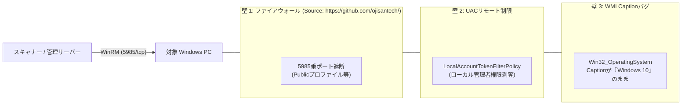

# 【第9弾 詳細解説】Windows 11怪奇現象 ＆ WinRM現場トラブル編 - Windows 11 なのに「Win32_OperatingSystem」が Windows 10 と返してくる怪奇現象。自宅ラボでWinRMエージェントレス管理を実装してハマった5つの罠と解決策

> **対象読者**: Windowsインフラ管理者、ヘルプデスクSE  
> **主要技術スタック**: PowerShell, WMI (`Win32_OperatingSystem` / `BuildNumber`), WinRM, UACリモート制限解除 (`LocalAccountTokenFilterPolicy`)  
> **検証環境・位置づけ**: 個人自宅ラボ（ホームラボ／仮想環境）における公開情報・OSSベースの個人研究（PoC）  
> **ライセンス**: [MIT License](https://github.com/ojisantech/ojisan-arsenal/blob/main/LICENSE)  


> 💡 **【検証環境・個人研究（PoC）に関する注記】**  
> 本記事は、筆者個人の自宅検証環境（ホームラボ／仮想環境）において、公開情報およびOSS（オープンソースソフトウェア）を用いて独自に構築・検証した個人研究（PoC）の記録です。特定の企業・団体の実環境や業務上の非公開情報とは一切関係ありません。

---

## 1. 概要と背景（サマリーからの深掘り）

### なぜこの技術が現場で不可欠なのか：Windowsエージェントレス管理は「落とし穴」だらけ
常駐ソフトを入れずに、Windows標準機能である **WinRM（Windows Remote Management）** を使ってLAN内PC端末のスペックやOSバージョン、インストール済みソフトを収集する――。

構想としては最高ですが、実際に現場のPCで動かそうとすると、**Microsoftの歴史的な仕様やセキュリティ制限による「地獄の罠」** が次々と襲いかかってきます。

* 「Windows 11の最新PCを買ってきたのに、OS名が『Windows 10』と取得される」
* 「管理者パスワードは合っているのに、なぜかAccess is denied（アクセス拒否）される」
* 「セットアップ用PowerShellを実行しようとしたらセキュリティで弾かれる」

本記事では、筆者がLAN内のサーバー、PC、十数台をエージェントレス管理化する中で踏み抜いた **「5つの巨大な罠」** と、それらを一撃で解決する **「全自動セットアップバッチ（要点抜粋）」** を解説します。

従来の画一的なアプローチや商用ブラックボックス製品に頼る運用では、ライセンス費用の高騰や仕様変更に伴うベンダーロックイン、さらには現場特有のエッジケースに対する対応力の欠如が深刻なボトルネックとなります。
本稿では、オープンソースおよび標準技術の基本原理に立ち返り、外部コストゼロかつ自立運用可能なアーキテクチャの完全実装と運用基準を詳細に解説します。

---

## 2. アーキテクチャと深層メカニズム

### システム俯瞰図：WinRMエージェントレス接続を阻む5つの壁
スキャナーからの接続要求をブロックするWindowsの多層セキュリティ制限と、その解除ポイントの全体構造は以下の通りです。



### 内部動作メカニズムと「5つの罠」の深層解説

#### 罠 1：Windows 11 なのに WMI が「Windows 10」と嘘をつく問題
Windows 11端末に対して PowerShell や WMI でOS名を取得しようとすると、環境やWMIキャッシュ状態によって `Caption` が `Windows 10` 系として返る怪奇現象に遭遇します。  
これはバグではなく、**Microsoftが古いソフトウェアとの後方互換性を保つために内部カーネルメジャーバージョン（`10.0`）を維持している仕様**に起因します。`Caption` 文字列だけを信用していると、「Windows 11へ移行したはずのLAN内PC端末が、資産台帳上ですべて『EoL済みのWindows 10』として検知され続ける」という大混乱に陥ります。  
➔ **解決原理**: Windows 11の初版ビルド番号は **`22000`** です。OS判定ロジックでは必ず `BuildNumber >= 22000` を評価して確定させます。

#### 罠 2：管理者パスワードが合っているのに「Access is denied」される（UACリモート制限）
Active Directory配下のドメイン管理者ではなく、**ワークグループ環境やローカル管理者アカウント**を使ってWinRM接続しようとすると、正しいID/PWを入力しても `Access is denied` で接続が拒否されます。  
これはWindows Vista以降に導入された **「リモートUAC制限（UAC Remote Restrictions）」** が原因です。ネットワーク経由（ネットワークログオン）でローカル管理者がログインしてきた場合、Windowsは自動的に管理者トークンをフィルタリングし、「一般ユーザー（制限トークン）」に格下げしてしまいます。  
➔ **解決原理**: レジストリ `HKLM\SOFTWARE\Microsoft\Windows\CurrentVersion\Policies\System\LocalAccountTokenFilterPolicy = 1` を設定し、ローカル管理者の昇格トークンをリモートWinRMセッションへそのまま通過させます。

#### 罠 3：PowerShellスクリプト（`.ps1`）が実行ポリシー（`ExecutionPolicy`）で停止する
設定用スクリプトを `.ps1` で作成してLAN内の全員（家の中だと奥さん、こどもなど）に配布しても、ダブルクリックではメモ帳が開くだけで実行できず、右クリック実行しても `PSSecurityException`（スクリプトの実行が無効）で停止します。  
➔ **解決原理**: 非エンジニアの利用者にコマンド手打ちを強いるのではなく、標準の `.bat`（コマンドプロンプト）でラッパーを作り、内部から `powershell.exe -NoProfile -ExecutionPolicy Bypass` を呼び出すワンクリック構成にします。

#### 罠 4：ネットワークプロファイルが「パブリック」だと5985番ポートが遮断される
WinRMの標準ポートは **`5985/tcp` (HTTP)** です。LAN内に接続しているにもかかわらず、Windowsがネットワークを誤って「パブリックネットワーク（Public）」と認識している場合、`winrm quickconfig` だけではパブリックプロファイルの通信が遮断されることがあります。  
➔ **解決原理**: `netsh advfirewall` で対象サブネット（例: `192.168.1.0/24`）または対象プロファイルに対して明示的にインバウンド許可ルールを構成します。

#### 罠 5：初期構築から42日後に突然WinRMが切れる（パスワード有効期限切れの時限爆弾）
初期セットアップから42日（Windowsの既定パスワード有効期間）が経過したある日、**全端末から一斉に情報が取れなくなる**という時限爆弾が爆発します。診断用ローカルアカウントのパスワード有効期限が切れてロックされるためです。  
➔ **解決原理**: 診断アカウント作成時に `PasswordExpires=FALSE`（パスワード無期限）を明示設定します。

---

## 3. 実装詳細とパラメータ完全解説

本アーキテクチャの要となるコアコードおよび「一撃解消セットアップバッチ」の要点抜粋です。

### ① 罠 1 の再現と Python 側での正確な Windows 11 ビルド判定ロジック

```powershell
# PowerShell / WMI での怪奇現象再現例
Get-CimInstance Win32_OperatingSystem | Select-Object Caption, BuildNumber
# 実行結果例:
# Caption                   BuildNumber
# -------                   -----------
# Microsoft Windows 10 Pro  22631        <-- ビルドは Win11 (23H2) なのに Caption が Windows 10 になるケース
```

```python
# (Source: https://github.com/ojisantech/)
# 正確な Windows 11 判定ロジック (Python スキャナー側)
def detect_true_windows_os(caption: str, build_number_str: str) -> str:
    """
    WMI Win32_OperatingSystem の Caption と BuildNumber を突き合わせ、
    BuildNumber >= 22000 の場合は確実に Windows 11 として正規化する。
    """
    try:
        build = int(str(build_number_str).strip())
        if build >= 22000:
            # ビルド22000以上は Windows 11 (22000=21H2, 22621=22H2, 22631=23H2, 26100=24H2)
            return caption.replace("Windows 10", "Windows 11")
    except ValueError:
        pass
    return caption
```

---

### ② 罠 2〜5 を個別に解消するコアコマンド群

```cmd
REM 1. リモートUAC制限の解除（ローカル管理者でのWinRM接続許可）
reg add "HKLM\SOFTWARE\Microsoft\Windows\CurrentVersion\Policies\System" /v LocalAccountTokenFilterPolicy /t REG_DWORD /d 1 /f

REM 2. PowerShell ExecutionPolicy をバイパスしてワンライナー実行
powershell.exe -NoProfile -ExecutionPolicy Bypass -Command "Set-Service -Name WinRM -StartupType Automatic; Start-Service -Name WinRM"

REM 3. Windows ファイアウォールで WinRM (5985/tcp) を許可（LAN内サブネット限定推奨）
netsh advfirewall firewall add rule name="WinRM-HTTP-Inbound" dir=in action=allow protocol=TCP localport=5985 remoteip=localsubnet profile=any

REM 4. 診断専用ローカルアカウントの作成とパスワード無期限化（42日時限爆弾の解除）
net user AssetAdmin MyStrongPass123! /add
net localgroup Administrators AssetAdmin /add
wmic useraccount where "name='AssetAdmin'" set PasswordExpires=FALSE
```

---

### ③ 決定版：全LAN内に配る「一撃解消バッチ（要点抜粋）」

以上の5つの罠をすべて対策し、対象PCで「管理者として実行」する際に組み込むコア処理の抜粋です。

```bat
:: (Source: https://github.com/ojisantech/ - 要点抜粋)
:: ※実行時は管理者権限（昇格プロンプト）で実行してください

:: 1. WinRM サービスを有効化＆自動起動設定
powershell.exe -NoProfile -ExecutionPolicy Bypass -Command "Set-Service -Name WinRM -StartupType Automatic; Start-Service -Name WinRM"
call winrm quickconfig -q

:: 2. UAC リモート制限 (LocalAccountTokenFilterPolicy) を解除
reg add "HKLM\SOFTWARE\Microsoft\Windows\CurrentVersion\Policies\System" /v LocalAccountTokenFilterPolicy /t REG_DWORD /d 1 /f

:: 3. ファイアウォール 5985番ポートをLAN内サブネット向けに開放
netsh advfirewall firewall add rule name="WinRM-AssetScan" dir=in action=allow protocol=TCP localport=5985 remoteip=localsubnet profile=any

:: 4. 診断用ローカルアカウント作成 ＆ パスワード無期限化
net user AssetAdmin StrongPassword999! /add
net localgroup Administrators AssetAdmin /add
powershell.exe -NoProfile -ExecutionPolicy Bypass -Command "Set-LocalUser -Name 'AssetAdmin' -PasswordNeverExpires $true"
```

---

### 主要パラメータ・設定値の技術的根拠

| パラメータ / 設定項目 | 推奨設定値 | 技術的根拠（なぜこの設計なのか） |
| :--- | :--- | :--- |
| **OSビルド判定境界 (`BuildNumber`)** | `>= 22000` | Windows 10最終系（22H2）はビルド `19045` であり、Windows 11初版（21H2）は `22000` から始まるため、文字列ではなく整数比較を行うことで100%確実にWin10/11を識別できる。 |
| **`LocalAccountTokenFilterPolicy`** | `1` (`REG_DWORD`) | 既定値 `0` ではネットワーク経由のローカル管理者トークンから管理権限（`BUILTIN\Administrators`）が剥奪されるため、ワークグループ環境でのWinRM管理には `1` が必須となる。 |
| **FW 送信元制限 (`remoteip=localsubnet`)** | `localsubnet` または管理サーバーIP | `profile=any` でパブリックプロファイル誤判定による遮断を回避しつつ、許可IPを `localsubnet`（または診断ゲートウェイの固定IP）に絞ることで外部ネットワークからの不正接続を遮断する。 |
| **パスワード無期限化 (`PasswordNeverExpires`)** | `$true` (`FALSE`) | Windows標準のローカルアカウントポリシー（42日有効期限）による突然の認証ロックアウト（時限爆弾）を恒久的に防ぐため。 |

---

## 4. 現場運用・アンチパターンと回避策

1. **ビルド番号テーブルによるバージョン名解決**:  
   単にWin10/Win11を分けるだけでなく、`22000` (21H2)、`22621` (22H2)、`22631` (23H2)、`26100` (24H2) のマッピングテーブルをスキャナー側に持たせることで、機能更新プログラムの適用状況まで正確に台帳化できます。
2. **最新Windows 11（24H2以降）での `wmic` 廃止への備え**:  
   Windows 11 24H2以降では従来の `wmic.exe` コマンドが標準で非推奨・削除対象となっています。バッチ内のパスワード無期限化は `powershell -Command "Set-LocalUser -Name 'AssetAdmin' -PasswordNeverExpires $true"` または `net accounts /maxpwage:unlimited` を併用すると将来にわたって安全です。

### 避けるべきアンチパターン
- **アンチパターン1：バッチ内に簡単な推測可能パスワードをハードコードしたまま無制限公開する**  
  `LocalAccountTokenFilterPolicy=1` を有効化した状態で `Password123` のような弱いパスワードを全端末共通で設定し、さらに送信元IP制限を設けない場合、LAN内の別端末から横展開（Lateral Movement）されるリスクが生じます。ファイアウォールルールの `remoteip=` には必ず診断サーバーの固定IPを指定してください。
- **アンチパターン2：`Caption` 文字列の部分一致だけでEoLアラートを発報する**  
  `if "Windows 10" in caption:` のような単純判定を行うと、WMIの互換仕様によってWindows 11端末まで誤ってサポート終了（EoL）対象としてカウントしてしまいます。必ず `BuildNumber` を最優先の評価軸にしてください。
- **アンチパターン3：WinRMサービスを起動しただけで自動起動（`Automatic`）設定を忘れる**  
  `Start-Service WinRM` だけを実行して `StartupType` を `Automatic` に変更し忘れると、PCを再起動した瞬間にWinRMサービスが停止状態に戻り、翌日から再びスキャン不能になります。

---

## 5. トラブルシューティングガイド

障害発生時の一次切り分けフローおよび確認コマンド一覧です。

| 障害事象・エラーメッセージ | 想定原因 | 一次切り分け・復旧コマンド |
| :--- | :--- | :--- |
| **`Access is denied` (HTTP 401 / 500)** | UACリモート制限が有効のまま、または対象ユーザーが `Administrators` グループに未所属 | `reg query "HKLM\SOFTWARE\Microsoft\Windows\CurrentVersion\Policies\System" /v LocalAccountTokenFilterPolicy` で `0x1` か確認 |
| **`WinRM cannot complete the operation` (タイムアウト)** | WinRMサービス停止中、またはファイアウォール（Publicプロファイル等）で5985/tcpが遮断されている | 対象PCで `Test-WSMan` および `Get-NetFirewallRule -DisplayName "*WinRM*"` を確認 |
| **42日経過後に突然認証エラーで繋がらなくなった** | 診断用ローカルアカウントのパスワード有効期限切れ | `Get-LocalUser -Name "AssetAdmin" \| Select-Object PasswordExpires, PasswordLastSet` で期限を確認し、`Set-LocalUser -PasswordNeverExpires $true` を実行 |
| **Windows 11 24H2 で `wmic` コマンドがエラーになる** | Windows 11 24H2 以降での `wmic` 機能削除（Deprecated） | `wmic` の代わりに PowerShell の `Get-CimInstance` および `Set-LocalUser` コマンドレットへ置き換える |

---

## 6. 実務FAQ（よくある質問と回答）

**Q1: `LocalAccountTokenFilterPolicy = 1` を設定してもセキュリティ上問題ありませんか？**  
**A1**: この設定は「ローカル管理者アカウントでのリモート管理を許可する」ものであるため、単体で開放するとPass-the-Hash等のリスクが高まります。そのため、本稿のバッチのように **① ファイアウォール（`remoteip=`）で接続元IPを診断ゲートウェイ1台のみに限定すること**、**② 十分に長く複雑なパスワードを設定すること** を必ずセットで実施してください。

**Q2: 平文のHTTP（5985番）ではなくHTTPS（5986番）にしなくても通信の中身は盗聴されませんか？**  
**A2**: WinRMはHTTP（5985番）であっても、NTLMまたはKerberosのメッセージ暗号化（SPNEGO / Sealing）を用いることでペイロード自体は暗号化可能です。ただし、より厳格なセキュリティが求められる環境では、自己署名証明書または内部CA証明書をバインドしたWinRM HTTPS（5986番）の利用を推奨します。

**Q3: Windows HomeエディションのPCでもこの方法でWinRM管理できますか？**  
**A3**: Windows HomeエディションでもWinRM自体は動作しますが、ローカルグループ管理（`lusrmgr.msc`）や一部のリモート管理制限がProエディションと異なるため、原則としてビジネス・検証用途ではWindows 10/11 ProまたはEnterpriseエディションを対象とすることを推奨します。

---

## 7. 本番適用チェックリスト

- [ ] OS判定ロジックが `Caption` だけでなく `BuildNumber >= 22000` を基準にWindows 11を判定しているか
- [ ] 対象Windows PCの `WinRM` サービスのスタートアップの種類が「自動（`Automatic`）」になっているか
- [ ] ワークグループ環境の場合、`LocalAccountTokenFilterPolicy = 1` が設定されているか
- [ ] Windows Defender ファイアウォールの5985番ポート開放ルールに、送信元IP制限（`remoteip=診断サーバーIP`）が設定されているか
- [ ] 診断用ローカルアカウントに `PasswordNeverExpires = $true`（パスワード無期限）が設定されているか

---

## 8. ライセンス・著作権表示

本稿に掲載されているアーキテクチャ図、処理フロー、およびコード抜粋・スニペットは、[MIT License](https://github.com/ojisantech/ojisan-arsenal/blob/main/LICENSE) の下で公開されています。商用・非商用問わず自由にご利用・ご参照いただけますが、著作権表示および許諾表示の保持が必要です。

```text
MIT License

Copyright (c) 2026 ojisantech
```
