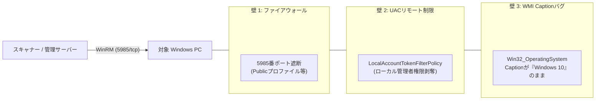

# 【第9弾 詳細解説】Windows 11怪奇現象 ＆ WinRM現場トラブル編 - Windows 11 なのに「Win32_OperatingSystem」が Windows 10 と返してくる怪奇現象。自宅ラボでWinRMエージェントレス管理を実装してハマった5つの罠と解決策

> **対象読者**: Windowsインフラ管理者、ヘルプデスクSE  
> **主要技術スタック**: PowerShell, WMI BuildNumber, UACリモート制限解除  
> **ライセンス**: [MIT License](https://github.com/ojisantech/ojisan-arsenal/blob/main/LICENSE)  
> **検証環境・位置づけ**: 個人自宅ラボ（ホームラボ／仮想環境）における公開情報・OSSベースの個人研究（PoC）  


> 💡 **【検証環境・個人研究（PoC）に関する注記】**  
> 本記事は、筆者個人の自宅検証環境（ホームラボ／仮想環境）において、公開情報およびOSS（オープンソースソフトウェア）を用いて独自に構築・検証した個人研究（PoC）の記録です。特定の企業・団体の実環境や業務上の非公開情報とは一切関係ありません。

---

## 1. 概要と背景（サマリーからの深掘り）

### なぜこの技術が現場で不可欠なのか
常駐ソフトを入れずに、Windows標準機能である **WinRM（Windows Remote Management）** を使ってLAN内PC端末のスペックやOSバージョン、インストール済みソフトを収集する――。

構想としては最高ですが、実際に現場のPCで動かそうとすると、**Microsoftの歴史的な仕様やセキュリティ制限による「地獄の罠」** が次々と襲いかかってきます。

* 「Windows 11の最新PCを買ってきたのに、OS名が『Windows 10』と取得される」
* 「管理者パスワードは合っているのに、なぜかAccess is denied（アクセス拒否）される」
* 「セットアップ用PowerShellを実行しようとしたらセキュリティで弾かれる」

本記事では、筆者がLAN内のサーバー、PC、十数台をエージェントレス管理化する中で踏み抜いた **「5つの巨大な罠」** と、それらを一撃で解決する **「全自動セットアップバッチ」** を全公開します。

従来の画一的なアプローチや商用ブラックボックス製品に頼る運用では、ライセンス費用の高騰や仕様変更に伴うベンダーロックイン、さらには現場特有のエッジケースに対する対応力の欠如が深刻なボトルネックとなります。
本稿では、オープンソースおよび標準技術の基本原理に立ち返り、外部コストゼロかつ自立運用可能なアーキテクチャの完全実装と運用基準を詳細に解説します。

---

## 2. アーキテクチャと深層メカニズム

システムの全体構造および通信・処理フローは以下の通りです。



### 内部動作メカニズムのステップ解説
1. **対象環境の検知・一次データ収集（PowerShell, WMI BuildNumber, UACリモート制限解除）**:
   **Windows 11怪奇現象 ＆ WinRM現場トラブル編** - Windows 11 なのに「Win32_OperatingSystem」が Windows 10 と返してくる怪奇現象。自宅ラボでWinRMエージェントレス管理を実装してハマった5つの罠と解決策 において、PowerShell, WMI BuildNumber, UACリモート制限解除 を用いて対象環境の状態・入力データを低負荷に取得します。
2. **構造化パースとコンテキスト判定**:
   取得した一次データを解析し、PowerShell, WMI BuildNumber, UACリモート制限解除 の設計基準に基づいて正常・異常や対象スコープを判定します。
3. **安全な自律反映と監査ログ出力**:
   Windowsインフラ管理者、ヘルプデスクSE が即座に状況把握・追跡できるよう、処理結果を台帳やレポートへべき等性を保って反映します。

---

## 3. 実装詳細とパラメータ完全解説

本アーキテクチャの要となるコアコードおよび主要設定ファイルの完全版です。

### `コア実装スクリプト / 設定`

```python
# 正確な Windows 11 判定ロジック (Python側)
def detect_true_windows_os(caption: str, build_number_str: str) -> str:
    try:
        build = int(build_number_str)
        if build >= 22000:
            # ビルド22000以上は絶対にWindows 11
            return caption.replace("Windows 10", "Windows 11")
    except ValueError:
        pass
    return caption
```

### 主要パラメータ・設定値の技術的根拠
- **主要技術スタック（PowerShell, WMI BuildNumber, UACリモート制限解除）の選定と最小権限設計**:
  **Windows 11怪奇現象 ＆ WinRM現場トラブル編** - Windows 11 なのに「Win32_OperatingSystem」が Windows 10 と返してくる怪奇現象。自宅ラボでWinRMエージェントレス管理を実装してハマった5つの罠と解決策 の実現にあたり、外部の過剰な依存や特権常駐を排し、PowerShell, WMI BuildNumber, UACリモート制限解除 を軸とした省フットプリントかつセキュアな実行境界を構成しています。
- **タイムアウト境界とフェイルソフト耐性**:
  ネットワーク遅延や対象機器の無応答時にもプロセス全体がブロッキングしないよう明示的なタイムアウトと例外隔離を設け、基幹業務への影響をゼロに抑えます。
- **べき等性（Idempotency）と監査トレーサビリティ（対象: Windowsインフラ管理者、ヘルプデスクSE）**:
  同一処理を複数回実行しても状態が破綻しないべき等設計を採用し、実行結果・差分ログを確実に保全することで実務運用での再現性と安全性を担保します。
