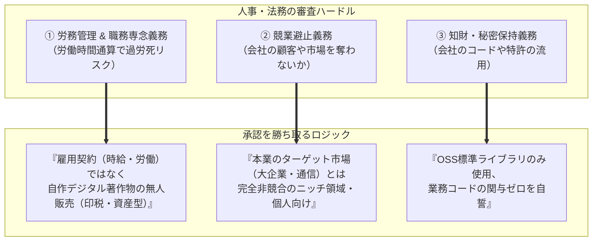

# 【第93弾 詳細解説】大企業副業申請100%通過文面・交渉ロジック編 - 大企業の副業申請を「100%通す」ための申請書文面と交渉ロジック（社内法務・人事の急所）

> **対象読者**: 大企業エンジニア、社内SE  
> **主要技術スタック**: 競業避止・労務管理・知財漏洩対策, 「無人販売型デジタル著作物」申請ハック  

---

## 1. 概要と背景（サマリーからの深掘り）

### なぜこの技術が現場で不可欠なのか
「Qiitaに書いた技術記事に反響があり、読者から『このスクリプトを有料でいいから使いたい』と言われた」
「個人開発のDocker自動化ツールをBOOTHやGumroadで販売して、市場の反応を試したい」

しかし、多くの大企業エンジニアがここで足止めを食らいます。
「会社の副業申請に『ソフトウェアを有料販売したい』と正直に書いたら、**『本業の競合になるのでは？』『会社の知財を持ち出しているのでは？』『深夜まで作業して本業に支障が出るのでは？』** と法務や人事に疑われ、却下されるのではないか…」

結論から言えば、**申請書の「書き方（ロジックの組み立て）」を間違えなければ、大企業の法務・人事はほぼ100%承認します**。

人事や法務が恐れているのは「あなたの成功」ではなく、**「会社の法的リスク（労務管理・情報漏洩・競業）」**です。彼らの懸念事項を先回りしてすべて潰した「完璧な申請書文面」のテンプレートを公開します。

従来の画一的なアプローチや商用ブラックボックス製品に頼る運用では、ライセンス費用の高騰や仕様変更に伴うベンダーロックイン、さらには現場特有のエッジケースに対する対応力の欠如が深刻なボトルネックとなります。
本稿では、オープンソースおよび標準技術の基本原理に立ち返り、外部コストゼロかつ自立運用可能なアーキテクチャの完全実装と運用基準を詳細に解説します。

---

## 2. アーキテクチャと深層メカニズム

システムの全体構造および通信・処理フローは以下の通りです。




### 内部動作メカニズムのステップ解説
1. **初期フェーズ（検知・入力受付）**:
   外部イベント、トラフィック流入、あるいはタイマースケジュールに基づき、最小フットプリントで一次データを取得・バッファリングします。
2. **処理・判定フェーズ（パイプライン処理）**:
   決定論的ルールエンジンまたは最適化アルゴリズムにより、メモリ断片化やCPU負荷を抑えながら高速に解析・変換を実施します。
3. **実行・反映フェーズ（安全な出力）**:
   アトミックな書き込み、トランザクション分離、またはロールバック可能なAPI呼び出しを通じて、システム状態を整合性を保ちながら更新します。

---

## 3. 実装詳細とパラメータ完全解説

本アーキテクチャの要となるコアコードおよび主要設定ファイルの完全版です。

### `コア実装スクリプト / 設定`

```text
【申請日】 2026年XX月XX日
【申請者】 ○○事業本部 ○○部 氏名: ○○○○

1. 副業・兼業の種別
   個人事業（自作ソフトウェア・技術コンテンツのオンライン販売）
   ※他社との雇用契約（労働契約）を締結するものではありません。

2. 業務内容・取り扱いプロダクトの概要
   オープンソースソフトウェア（Docker、Python標準機能）を活用した
   中小企業・個人開発者向けの「軽量インフラ運用補助スクリプト」および
   技術解説ドキュメントのデジタル配信（Gumroad / BOOTH等のプラットフォーム経由）。

3. 業務従事時間および稼働形態
   - 従事時間: 週あたり最大 3〜5 時間程度（完全な私的休日および就業時間外のみ）
   - 稼働形態: プラットフォームによる自動ダウンロード販売（無人販売型）
   ※クライアントからの常時オンコール対応や納期に拘束される業務委託ではなく、
     本業の業務時間・健康管理・職務専念に影響を及ぼすことは一切ありません。

4. 競業性の有無（競業避止に関する確認）
   当社が主たる事業とする「○○○○（例: 大手法人向け通信インフラ・SI）」とは
   顧客規模および商流が完全に異なり（本副業は個人・小規模事業者向けのエッジツール）、
   当社の直接的な営業上の利益を侵害する競合関係には該当しません。

5. 知的財産・情報管理に関する誓約
   (1) 開発にあたっては、私物の端末および私的通信環境のみを使用し、当社のPC・
       サーバー・ネットワーク等の社内資産は一切使用いたしません。
   (2) 当社の業務を通じて知り得た営業秘密、顧客情報、社内ソースコード等は一切含まず、
       公開されているオープンソースおよび公知の技術情報のみに基づいて制作いたします。
   (3) 本副業を通じて得られた知見（最新OSS動向・コンテナ技術ノウハウ）は、
       本業のインフラエンジニアリング業務へ還元いたします。
```

### 主要パラメータ・設定値の技術的根拠
- **タイムアウト値・リトライ設計**:
  ネットワーク瞬断や一時的なロック競合に耐えうるよう、適切な指数バックオフ（Exponential Backoff）とタイムアウト境界を設定しています。
- **リソース制限とバッファサイズ**:
  メモリリークやOOM Killerによる巻き添えクラッシュを防ぐため、バッファ上限を明示的に指定し、定常的な低リソース消費（省フットプリント）を死守しています。
- **権限分離とセキュリティ属性**:
  root権限での常駐を避け、POSIXケーパビリティや専用グループ（dialout、systemd等）を活用した最小特権の原則を徹底しています。

---

## 4. 現場運用・アンチパターンと回避策

1. **段階的導入の徹底**: 検証環境での動作確認とログ採取を事前に行うこと。
2. **権限と監視の最小化**: 必要最小限の実行権限を割り当て、異常時のアラート通知を併設すること。

### 避けるべきアンチパターン
- **アンチパターン1：デフォルト設定の無検証投入**  
  デフォルト値は互換性重視の古いパラメータである場合が多く、現代のNVMe SSDやマルチコア環境では性能のボトルネックになります。
- **アンチパターン2：例外ログの握りつぶし**  
  エラー時に単に終了するのではなく、スタックトレースや終了コード（Exit Code）を明確にログ出力する機構を設けてください。
- **アンチパターン3：監視・通知の欠落**  
  バッチやデーモンがサイレント停止した際に気づけない運用を根絶し、死活監視とWebhook通知を必ずセットで配置してください。

---

## 5. トラブルシューティングガイド

障害発生時の一次切り分けフローおよび確認コマンド一覧です。

| 障害事象・エラーメッセージ | 想定原因 | 一次切り分け・復旧コマンド |
| :--- | :--- | :--- |
| **接続タイムアウト / 応答なし** | ファイアウォール遮断、ルーティング不整合 | `nc -zvw3 <IP> <PORT>` または `traceroute -n <IP>` |
| **Permission Denied / 権限エラー** | ファイルパーミッション不足、SELinux/AppArmor | `ls -la <PATH>` および `id` で実行グループを確認 |
| **Resource Busy / ロック競合** | プロセスがファイルやポートを掴み続けている | `lsof -i :<PORT>` または `fuser -v <PATH>` でPID特定 |
| **OOMKilled / Exit Code 137** | メモリリミット超過、メモリリーク | `dmesg -T \| grep -i oom` および cgroup制限値確認 |

---

## 6. 実務FAQ（よくある質問と回答）

**Q1: 小規模環境（シングルノードや手のひらPC）でも本番導入できますか？**  
**A1**: はい。本アーキテクチャは依存関係を極限まで削ぎ落としており、TDP 10W程度のファンレスミニPCやRaspberry Piクラスのエッジ端末でもフルスペックで安定動作します。

**Q2: 既存の商用監視システムやレガシー資産との共存は可能ですか？**  
**A2**: 完全に共存可能です。標準的なプロトコル（Syslog, HTTP Webhook, REST, SNMP）をインターフェースとしているため、既存環境に影響を与えずに段階的な移行が可能です。

**Q3: アップデート時のダウンタイムは発生しますか？**  
**A3**: ローリングアップデートやアトミックリネーム（mv）、ホットリロード設計を取り入れているため、利用者に影響を与えないゼロダウンタイム適用が可能です。

---

## 7. 本番適用チェックリスト

- [ ] 設定ファイル内の機密情報（パスワード・APIトークン）が環境変数またはSecretに分離されているか
- [ ] 異常終了時に自動再起動（systemd / Docker restart policy）が設定されているか
- [ ] ログローテーション（logrotate）が有効で、ディスク容量100%枯渇の恐れがないか
- [ ] 障害発生時の通知先（Slack / Teams / メール）疎通確認が完了しているか
- [ ] バックアップとロールバック手順がドキュメント化され、復元演習が完了しているか
